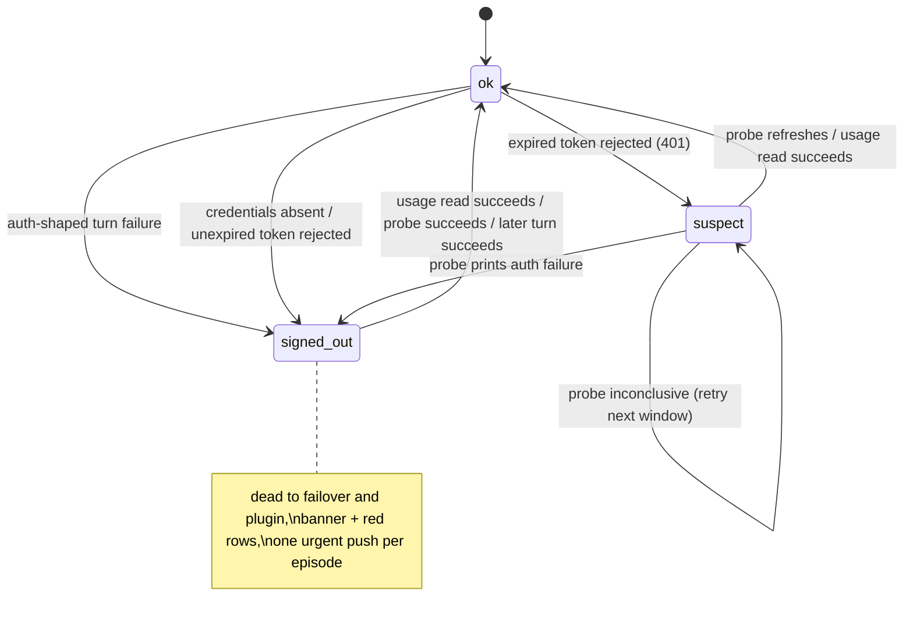
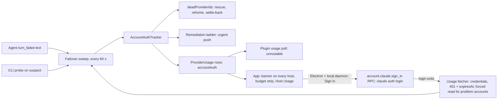

# Signed-Out Claude Accounts Are Detected, Routed Around, and Impossible to Miss - Plan

## Goal Capsule

- **Objective:** when any enabled pooled Claude account stops being able to authenticate (signed out, or an OAuth session that expired and cannot refresh), the daemon notices by itself, stops routing work to it, moves the agents stuck on it, pushes one urgent alert, and shows a red banner in every client until the account works again. On a desktop app running beside the daemon, the banner signs the account in with one click.
- **Authority:** this plan, then `docs/account-failover.md`, `docs/notification-policy.md`, `docs/remediation.md`, `docs/protocol-compatibility.md`, `docs/design.md`, `CLAUDE.md`.
- **Execution profile:** two workers in separate worktrees. Worker A owns the daemon, protocol and plugin, in order: U1, U2, U4, U3, U5, U7. Worker B owns the app: U6, started once Worker A has committed U4's protocol field and RPC schema. No file is edited by both workers. The leader merges A, then B.
- **Stop conditions:** stop and report if detection would mark an account signed out from a single 401 with no corroboration, if a fix would make the usage fetcher write or refresh credentials, if a protocol change would make an old client fail to parse, or if the probe would bill a turn on an account that has a running agent.
- **Tail ownership:** workers commit locally on their branches and never push, open PRs, or restart the 6767 daemon. The leader reviews, merges, stages the build, and verifies on device.

---

## Product Contract

### Problem Frame

On 2026-10-12 the `claude-personal` worker's OAuth session expired and could not refresh. Thirteen turns failed with `Failed to authenticate: OAuth session expired and could not be refreshed` between 17:55Z and 18:27Z, a remediation agent died the same way, and the classifier kept starting children there. Later the `claude-backup` account (`~/.claude`) was signed out too. Tyler only found out because an agent told him. He asked for this to be automatic, with a very noticeable error when any of his three accounts is not working.

Nothing caught it because every detector looks elsewhere:

- `readClaudeAccountAuth` reads `oauthAccount` in `.claude.json`, which stays present after expiry.
- `claude auth status`, the keychain item, and `.claude.json` all still say signed in for an expired-and-unrefreshable session. Only agent error text and the usage API's 401 show it.
- The usage fetcher folds a 401/403 and missing credentials into `status: "unavailable"`, and failover deliberately never treats `unavailable` as dead.
- The daemon's dead-account rule (`isLimitShapedError`) and the plugin's `AUTH_FAILURE_PATTERN` both miss the `Failed to authenticate: OAuth session expired` text. The plugin's 5-minute auth cap then decays to `probation`, which is routable, so spawns retry the dead account every 5 minutes.

### Requirements

- R1. The daemon classifies each enabled pooled Claude account's sign-in as `ok`, `suspect` or `signed_out`, and keeps it current without a restart.
- R2. Reactive evidence: an agent turn on the account fails with auth-shaped text (`Failed to authenticate`, `OAuth session expired`, `OAuth token revoked`, `Not logged in`, `Session expired`/`Your session has expired`, `Please run /login`, `Invalid API key`) marks the account `signed_out`. `OAuth access token could not be refreshed: another Claude Code process is holding the refresh lock` is transient and never counts.
- R3. Proactive evidence: credentials absent while `.claude.json` names an account, or the usage API rejecting an access token that has not expired, marks it `signed_out`. A 401 on an expired access token marks it `suspect` and triggers a confirming probe (R4).
- R4. A suspect account is confirmed or cleared by a CLI probe run with that account's `CLAUDE_CONFIG_DIR`, at most once per account per 15 minutes, never while an agent is running on the account. A refresh that succeeds clears it; auth-shaped output confirms `signed_out`; any other result (timeout, crash, unrelated error) leaves the state unchanged until the next window.
- R5. `signed_out` clears as soon as a usage read succeeds, a probe succeeds, a turn on the account succeeds after the evidence, or a sign-in started from the app finishes and the next check passes. There is no fixed expiry. Each failover sweep reads usage for `suspect` and `signed_out` accounts past the 5-minute usage cache, so recovery is seen within one sweep.
- R6. A `signed_out` account is dead to failover and to the account-pool plugin: no new agent or child is started on it, agents stuck on it are rescued, idle roots move, and roots settle back once it recovers. Disabled providers are ignored.
- R7. Each episode raises exactly one push at `urgent`, naming the account, its login and the sign-in command, and closes when the account recovers. A later sign-out raises a new one.
- R8. Every client (iOS, Android, web, Electron desktop) shows a banner at the top of the app while any enabled account on any connected host is `signed_out` (filled red) or has an identity problem (wrong login, shared login; amber when nothing is signed out). Signed-out entries come first. Each entry names the account, the problem, the host when more than one is connected, and the sign-in command to copy. It disappears without a reload once fixed. A `suspect` account shows nothing.
- R9. The account's row in the budget strip and the Host Usage card shows the same line: red for `signed_out`, amber for identity problems as today.
- R10. On Electron desktop, for an entry whose host is the desktop's own local daemon, the banner has a Sign in button that runs `claude auth login --email <email>` with the account's `CLAUDE_CONFIG_DIR` on that host, opening the OAuth page pre-filled with that account's email. The email is the entry's declared `params.accountPool.email`, else the last login recorded in that config dir's `.claude.json`. One login per account runs at a time; the button reads "Signing in…" until the entry clears or 3 minutes pass. Other entries show "Run on <host>" with the copy button.
- R11. Old clients keep working against a new daemon and new clients against an old daemon: new wire fields are optional, and the Sign in button is gated on a `server_info.features` flag.

### Scope Boundaries

- Usage caps stay with failover and never reach the banner or this push.
- Disabled providers get no banner, push or probe. Disabling an account is how Tyler silences one he has abandoned; each banner entry's label opens the host's provider settings.
- Signing in without Tyler is impossible (the browser approval is his) and not attempted. The desktop button opens the page; it does not complete it.
- Codex and other providers are out of scope.

### Deferred to Follow-Up Work

- Fold `~/bozeo-ops/claude-token-keepalive.mjs` into the daemon. Until then it keeps idle tokens fresh and the daemon's probe only confirms suspect accounts.
- `paseo doctor`'s `accounts` check reading the daemon's auth state so it can see an expired session.
- Signing in from a phone (the CLI's OAuth callback goes to the host's localhost; a phone would need a manual-code flow).

---

## Planning Contract

### Key Technical Decisions

- **How loud, and how the fix starts.** Urgent push plus a persistent banner and red rows; on desktop a one-click Sign in that opens the login page. (session-settled: user-directed — chosen over push-only, banner-only, auto-opening the login page on detection, or showing the command only: Tyler's answers on 2026-10-12.)
- **What counts.** Sign-in problems on enabled accounts only, with the existing wrong-login and shared-login problems shown in the same banner; caps stay with failover; a signed-out leader's agents move like a cap. (session-settled: user-approved — chosen over also bannering capped accounts or disabled accounts.)
- **A tracker owns the state; the sweep feeds it.** `AccountAuthTracker` (daemon) is pure state, one record per provider, with the episode shape of `PoolAccountIdentityTracker` (`packages/server/src/server/agent/pool-account-identity.ts:117-137`): `observe()` reports newly standing problems and forgets cleared ones, which re-arms. The failover monitor's 60-second sweep gathers the inputs (turn failures, the fetcher's auth reading, probe results) and hands them to the tracker; the tracker imports nothing from the fetcher or probe. Limit evidence lives 5 hours because a cap outlives its evidence; sign-in evidence clears the moment the account works, or the account stays dead for hours after Tyler signs in.
- **A 401 alone is never proof.** The CLI owns refresh and refreshes lazily (`docs/providers.md:209`), so an idle account answers 401 on an expired access token while its refresh token is fine. The fetcher reads `claudeAiOauth.expiresAt` read-only: a rejected token that has not expired is revoked (strong); a rejected expired token is only `suspect` until the probe answers.
- **The probe is the CLI itself, and only for suspects.** The keepalive already proved that a one-line `claude -p` with the account's config dir refreshes first and fails with the auth text when it can't. U2 first checks whether a non-billing invocation (`claude -p /context --no-session-persistence`, which makes no API call) also forces the refresh; if it does, that is the probe, else a single Haiku `reply ok` turn, the keepalive's command. It never runs on an account with a running agent, at most once per 15 minutes, and an inconclusive result changes nothing. The keepalive keeps running for idle accounts that are not suspect.
- **The fetcher stays read-only on credentials.** It never refreshes, writes, or deletes a token; refresh tokens are single-use and the CLI owns them.
- **Recovery is not held back by the usage cache.** `ProviderUsageService` caches a Claude read for 5 minutes and nothing forces a refresh today. The sweep force-reads only the `suspect` and `signed_out` providers, a set of at most three, so the cache stays in force for healthy accounts.
- **The wire gets a sibling field, not a new status.** `ProviderUsageStatusSchema` is a closed enum and an old client would fail on a new value. Rows gain an optional `accountAuth` object next to `accountIdentity` (`packages/protocol/src/messages.ts:7117-7136`), attached per read the way `ProviderUsageService.withAccountIdentity` does. Its `state` is the string `"signed_out"` when present; absence means nothing is known to be wrong.
- **The banner polls usage rows itself.** `useProviderUsage` only polls when a caller asks; today only the orchestration panel's budget strip does. The banner hook asks for the same options the strip passes (`refetchInterval` at the strip's 75 s, `catchUpOnFocus: true`) for every connected host that serves the usage list, so the banner shows on every screen without a new subscription, permission entry or emit path.
- **The push goes through the remediation ladder.** One observation per account, key `account-signed-out:<providerId>`, `remedy: "none"`, no escalation, `level: "urgent"`, reported every sweep while active and once `active: false` on recovery, which closes the episode. `account-failover-stranded` (`agent-account-failover-monitor.ts:607-624`) is the template.
- **Sign in is a daemon RPC, offered only where it works.** `account.claude.sign_in.request` / `.response` (permission `daemon.manage`, flag `server_info.features.claudeAccountSignIn`) spawns `claude auth login --email <email>` detached with the entry's env, through an argv array, never a shell string. The daemon already knows the binary (`resolveProviderLaunch`), the config dir and the email. It runs one login per provider at a time and forces that provider's usage recheck when the login process exits. The app offers the button only on Electron and only for the desktop's own local daemon (`desktopManaged` / `useLocalDaemonServerIdState`): on a remote host the OAuth page would open where Tyler is not.
- **A top-of-app banner, not a sidebar callout.** `docs/design.md` §11 puts app-wide alerts in `useSidebarCallouts()`, but the sidebar is hidden on compact layouts and this alert has to show on every screen. The shared `Alert` error variant is quiet (outlined) by design; the banner adds a filled emphasis to it (destructive fill, destructive foreground) instead of hand-rolling one.
- **The plugin gets a durable signed-out state.** Its usage poller (`plugins/claude-account-pool/server/usage-poll.ts`) maps `accountAuth`; the health tracker marks the account unroutable while it is present, instead of the 5-minute cap that decays to `probation`. `AUTH_FAILURE_PATTERN` gains the missing strings and a drift test against the daemon's pattern, like `LIMIT_PATTERN` (`classify.test.ts:32`).

### High-Level Technical Design

Account sign-in state, per enabled pooled provider:

Where the state flows:

### Sources

- Incident evidence: 13 `turn_failed` lines on `claude-personal` in `~/.paseo/daemon.log`, 2026-10-12 17:55Z-18:27Z.
- Auth strings from the pinned CLI 2.1.291 binary, including the transient refresh-lock message to exclude.
- `6e24d27e6` is the full vertical slice for `accountIdentity` (protocol field, tracker, push, app row, i18n, doctor, docs): copy its shape.
- `~/bozeo-ops/claude-token-keepalive.mjs`: the refresh-forcing `claude -p` and its keychain `expiresAt` read.

---

## Implementation Units

### U1. Auth classification and the account auth tracker

**Goal:** one place decides whether an account can authenticate.
**Requirements:** R1, R2, R5, R6 (disabled filter).
**Dependencies:** none.
**Files:** `packages/server/src/server/agent/account-auth-health.ts` (new), `packages/server/src/server/agent/account-auth-health.test.ts` (new), `packages/server/src/server/agent/account-failover-detector.ts`, `packages/server/src/server/agent/providers/claude/account-auth.ts`.
**Approach:** add `isAuthShapedError` beside `isLimitShapedError`, matching the R2 strings and rejecting the refresh-lock message, and `isAccountDeadError` (either one). `AccountAuthTracker` holds `{ state, since, evidence, fixCommand, email }` per provider id. Its update takes plain inputs from the caller: auth-shaped turn failures dated by the agent's newest timeline row (the failover detector's dating rule), an auth reading per provider, and probe results. It imports nothing from the fetcher or probe. It clears on any success newer than the evidence. `observe()` returns opened and closed episodes. It skips disabled entries (`resolveAccountPoolEntries` `enabled`). `fixCommand` comes from `claudeSignInCommand` with the declared email, else the last `oauthAccount.emailAddress` in that dir's `.claude.json`, so leader and backup stop falling back to the TTY-only `claude /login`.
**Patterns to follow:** `PoolAccountIdentityTracker`; `planAccountFailoverSweep` evidence dating.
**Test scenarios:**

- Each R2 string marks `signed_out`; the refresh-lock string and a limit message do not.
- A turn failure older than a later successful turn on the same account does not mark it.
- A successful usage read after `signed_out` returns `ok` and `observe()` reports the episode closed; a second sign-out opens a new episode.
- A `rejected_expired` reading gives `suspect`; an inconclusive probe leaves it `suspect`; an auth-shaped probe gives `signed_out`.
- A disabled provider with auth-shaped failures produces no record.
- `fixCommand` uses the declared email, falls back to the `.claude.json` email, and to `claude /login` only when neither exists.
  **Verification:** the new test file passes; existing `account-failover-detector` tests unchanged and green.

### U2. Fetcher auth reading, forced reads and the confirming probe

**Goal:** the usage fetcher says why it has no usage, problem accounts are re-read promptly, and a suspect account gets confirmed or cleared.
**Requirements:** R3, R4, R5.
**Dependencies:** U1.
**Files:** `packages/server/src/services/quota-fetcher/providers/claude.ts`, its test, `packages/server/src/services/quota-fetcher/service.ts` and its test, `packages/server/src/server/agent/account-auth-probe.ts` (new) and test, `packages/server/src/server/agent-account-failover-monitor.ts` (sweep wiring).
**Approach:** parse `claudeAiOauth.expiresAt` read-only. Expose an internal auth reading next to the usage result (`credentials_missing`, `rejected_unexpired`, `rejected_expired`, `ok`); the wire `status` stays `unavailable` as today. Give `ProviderUsageService` a forced read for a named set of providers. The sweep force-reads the tracker's `suspect` and `signed_out` providers, runs the probe for suspects (passing which accounts have a running agent, which the sweep already knows), and feeds all of it to the tracker. The probe runs the chosen CLI command with the entry's env and a short timeout and classifies its output as success, auth failure, or inconclusive.
**Execution note:** start with a spike on a scratch config dir: does `claude -p /context --no-session-persistence` refresh an expired access token (compare `expiresAt` before and after)? Record the answer in the probe's doc comment and pick the command from it.
**Test scenarios:**

- No keychain item and no `.credentials.json` while `.claude.json` has `oauthAccount` gives `credentials_missing`.
- 401 with `expiresAt` in the future gives `rejected_unexpired`; with `expiresAt` past gives `rejected_expired`.
- The fetcher never writes the keychain or `.credentials.json` (assert no write calls on the injected credential store).
- A forced read bypasses the cache only for the named providers; a healthy provider is still served from cache.
- The probe does not run twice inside 15 minutes, nor while an agent on the account is running; auth-shaped output confirms, a clean exit clears, a timeout or unrelated error is inconclusive.
  **Verification:** fetcher, service and probe tests pass; a 401 on an idle healthy account in a test never reaches `signed_out` without the probe.

### U4. Protocol field, row attachment and the sign-in RPC

**Goal:** clients can see the state, and desktop can start a sign-in.
**Requirements:** R8, R9, R10, R11.
**Dependencies:** U1, U2 (same `service.ts`).
**Files:** `packages/protocol/src/messages.ts`, `packages/server/src/services/quota-fetcher/service.ts` (`withAccountAuth`), `packages/server/src/server/websocket-server.ts` (feature flag), a new controller under `packages/server/src/server/session/` for the RPC, `packages/server/src/server/authorization/operation-permissions.ts`, the client method in `packages/client`, and tests beside each.
**Approach:** add optional `accountAuth: { state: "signed_out", since, summary, fixCommand, canSignIn }` to `ProviderUsageSchema` beside `accountIdentity`, tagged `// COMPAT(accountAuth)`. `canSignIn` is true when the daemon resolved a `claude` binary and an email or bare login for the entry. Attach it per read from the tracker. Add `server_info.features.claudeAccountSignIn` and the dotted RPC per `docs/rpc-namespacing.md`. The RPC validates the provider id against enabled pooled entries, takes no email or path from the request, spawns the login detached through an argv array, answers `started`, `already_running` or `failed` without waiting for the browser, and on the login process's exit asks the next sweep to force-read that provider.
**Test scenarios:**

- An old-shaped row (no `accountAuth`) and a new row both parse in the protocol tests; the schema has no transform/catch/preprocess.
- The row for a signed-out provider carries `accountAuth`; a healthy row omits it.
- The RPC refuses an unknown or disabled provider id and a principal without `daemon.manage`; for a valid one it spawns once with that entry's `CLAUDE_CONFIG_DIR` and the resolved email (assert argv through the injected launcher).
- A second request while that provider's login is running returns `already_running` and spawns nothing; the process's exit triggers a forced read.
  **Verification:** protocol, service and controller tests green; `npm run build:client` and the server typecheck clean.

### U3. Signed-out is dead to failover and the plugin

**Goal:** no work is routed to a signed-out account and stuck work leaves it.
**Requirements:** R6.
**Dependencies:** U1; the plugin half also U4 (it maps `accountAuth`).
**Files:** `packages/server/src/server/agent/account-failover-detector.ts`, `packages/server/src/server/agent-account-failover-monitor.ts`, the callers in the table below, `plugins/claude-account-pool/server/classify.ts`, `health.ts`, `usage-poll.ts`, `index.server.ts`, and their tests, plus `packages/server/src/server/agent-account-failover-monitor.e2e.test.ts`.
**Approach:** `planAccountFailoverSweep` adds the tracker's `signed_out` providers to `deadProviderIds`. Every caller of `isLimitShapedError` that asks "can this account serve" moves to `isAccountDeadError`; check each site and leave a one-line comment where limit-only semantics are kept on purpose:

| Caller                                               | Today, on a limit-shaped error             | Change                                                            |
| ---------------------------------------------------- | ------------------------------------------ | ----------------------------------------------------------------- |
| `agent-done-janitor.ts` `readProviderHealth`         | provider unhealthy                         | auth-shaped too                                                   |
| `account-failover-migration.ts` (two sites)          | target treated as dead                     | auth-shaped too                                                   |
| `account-failover-rehome.ts`                         | idle agent left to the rescue leg          | auth-shaped too                                                   |
| `account-failover-settle-back.ts`                    | not settled back                           | auth-shaped too                                                   |
| `agent-stall-sweep.ts`                               | stalled turn cancelled as `account-capped` | also on a signed-out account, reason `account-signed-out`         |
| `finish-obligation.ts` `gateDelivery`                | `wait` instead of `wake`                   | auth-shaped too, so a child is not woken into another failed turn |
| `finish-obligation-service.ts`                       | same family                                | auth-shaped too                                                   |
| `restart-recovery/service.ts`                        | turn not resumed in place                  | auth-shaped too                                                   |
| `agent-account-failover-monitor.ts` `retryUnresumed` | not retried in place                       | auth-shaped too                                                   |

In the plugin, map `accountAuth` in the usage poll and keep the account unroutable while it is present (no decay to `probation`); extend `AUTH_FAILURE_PATTERN` and add a drift test against the daemon's pattern.
**Test scenarios:**

- A worker marked `signed_out` gets no child spawn; the plugin returns its refused path naming the account.
- A root stuck on a signed-out worker is migrated to a healthy account; an idle root moves.
- A signed-out leader's roots move to a worker and settle back once the leader reads `ok` with a fresh usage reading.
- A finished child on a signed-out account is held (`wait`), not woken.
- The plugin keeps a signed-out account unroutable past 5 minutes and routes to it again once `accountAuth` disappears.
- The plugin pattern matches every R2 string; the drift test fails if either copy changes alone.
  **Verification:** unit tests green; `agent-account-failover-monitor.e2e.test.ts` run locally green before pushing.

### U5. The urgent push

**Goal:** one urgent alert per sign-out episode.
**Requirements:** R7.
**Dependencies:** U1.
**Files:** `packages/server/src/server/agent-account-failover-monitor.ts`, `packages/server/src/server/remediation/contract.ts` (new condition kind), `packages/server/src/server/agent/pool-account-identity.ts` (skip disabled entries), `push-callers.test.ts` and the monitor tests.
**Approach:** each sweep, observe every standing `signed_out` record to the ladder with key `account-signed-out:<providerId>`, kind `account-signed-out`, `remedy: "none"`, `level: "urgent"`, title "Claude account signed out: <label>", body naming the login and the sign-in command; send `active: false` once when it clears. Identity alerts stop firing for disabled entries, matching the scope decision.
**Test scenarios:**

- Two sweeps with the account signed out produce one push; recovery closes it; a second sign-out pushes again.
- Two accounts signed out produce two episodes with distinct keys.
- A disabled entry with a wrong login produces no identity alert.
  **Verification:** monitor and ladder tests green; the push inventory test passes with the new sender row.

### U6. Banner, rows and the Sign in button

**Goal:** the problem is impossible to miss in every client.
**Requirements:** R8, R9, R10, R11.
**Dependencies:** U4.
**Files:** `packages/app/src/account-alerts/account-alert-banner.tsx` (new), `packages/app/src/account-alerts/account-alert-model.ts` (new) and its test, `packages/app/src/app/_layout.tsx` (mount in `AppWithSidebar` above children), `packages/app/src/components/ui/alert.tsx` (filled emphasis), `packages/app/src/orchestration/account-budget-strip-model.ts` and `account-budget-strip-view.tsx`, `packages/app/src/provider-usage/card.tsx`, the i18n files for all 9 locales.
**Approach:**

- _Data:_ one hook polls `useProviderUsage` with `refetchInterval` (the strip's 75 s) and `catchUpOnFocus: true` for every connected host that serves the usage list, and merges their rows. The model lists enabled providers with `accountAuth` or `accountIdentity`: signed-out first, then identity, then by account label.
- _Look:_ filled red while any entry is signed out, amber when only identity problems stand; full width, not dismissible while a problem stands. While mounted, the banner owns the top safe-area inset and the top window-control clearance (notch, Android cutout, macOS traffic lights) per `docs/design.md` §9, and the screen below does not pad again.
- _Entries:_ label (opens that host's provider settings), problem, host name when more than one host is connected. On compact, one row per entry with a copy icon (the command is the copied value, not printed), at most two entries, then "+N more" opening host settings. On wide layouts the command is shown with a copy button.
- _Sign in:_ only on signed-out entries, and only when `getIsElectron()`, the feature flag, `accountAuth.canSignIn`, and the entry's host is the desktop's own local daemon all hold. It uses `<Button variant="outline" size="sm">`, calls the RPC for the entry's host, then reads "Signing in…" and is disabled until the entry clears or 3 minutes pass; the app refetches that host's usage on the RPC's answer and on window focus. A failed start shows the daemon's error under the button. Other entries show "Run on <host>" beside the copy button.
- _Rows:_ the budget strip and Host Usage card show the `accountAuth` line in the error colour; identity keeps `statusWarning`.
- Follow `docs/design.md`, `docs/unistyles.md` (no `useUnistyles()`), and the platform-gating rules in `CLAUDE.md`.
  **Test scenarios:**
- Model: rows with `accountAuth`, with `accountIdentity`, with both, and with neither produce the right entries, order and colour; a disabled provider produces none; rows from two hosts merge and name their hosts.
- The banner renders nothing against a daemon whose rows never carry `accountAuth`.
- Sign in renders only on Electron, with the flag, `canSignIn`, and the local daemon; a remote host's entry shows "Run on <host>"; after a click it shows "Signing in…" and a second click sends nothing.
- Compact layout shows at most two entries and a "+N more" row.
- The budget strip and Host Usage card show the red line for a signed-out row and keep amber for identity.
  **Verification:** app tests green, app typecheck clean; captures of the banner on web, macOS Electron (traffic lights), a notched iPhone and an Android cutout.

### U7. Docs

**Goal:** the docs say how sign-in failure is detected and surfaced.
**Requirements:** all.
**Dependencies:** U1-U6.
**Files:** `docs/account-failover.md` ("When an account is dead", "Which login each account is", "When Tyler hears", "Known limits"), `docs/notification-policy.md` (sender inventory), `docs/remediation.md` (condition kinds), `docs/providers.md` (the read-only `expiresAt` read), `docs/design.md` (§11: the filled Alert emphasis and the top banner exception).
**Approach:** integrate into the sections that own each fact; follow the doc voice in `CLAUDE.md`.
**Test expectation:** none -- docs only.
**Verification:** each fact appears once, others link to it.

---

## Verification Contract

- Targeted vitest only, per file: `npx vitest run <file>` from the owning package, never the full suite. Merge gate: the touched test files in one run without `--bail`, plus `agent-account-failover-monitor.e2e.test.ts` locally.
- `npm run build:client` before the app typecheck; server and app typecheck clean; test files typechecked with a scratch tsconfig against the base's error baseline.
- Lint and format with the worktree workaround (`--ignore-path` / `--no-ignore`).
- Live check on a scratch daemon (`docs/ad-hoc-daemon-testing.md`, never the 6767 daemon): a pool entry pointed at a scratch config dir whose `.claude.json` has an `oauthAccount` but no credentials reads `signed_out`, is skipped by spawns, raises one urgent push, and shows the banner; writing credentials back clears it within one sweep.
- Device: Tyler sees the banner on iPhone, Android and the desktop app, and the desktop Sign in opens the OAuth page for the right email.

## Definition of Done

- R1-R11 hold, each covered by a named test or the live check above.
- A signed-out enabled account can no longer receive a child agent, and today's incident replayed through the tracker's tests produces one urgent push and a banner.
- Docs updated per U7; no new untagged back-compat.
- No abandoned spike or probe code left in the diff.
