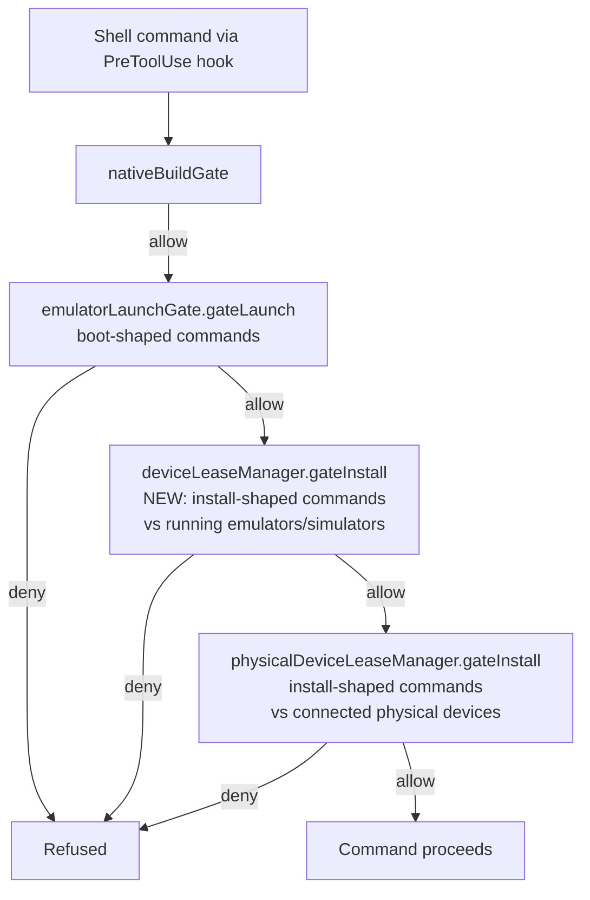

# fix: Emulator and simulator install gate

## Summary

PR #30 closed the physical-device install bypass (`PhysicalDeviceLeaseManager.gateInstall`,
`device-install-commands.ts`): an `adb install` or `simctl install` onto a phone or paired
iPhone another agent holds is refused. Emulators and simulators have no equivalent. The slot
cap's launch gate (`DeviceLeaseManager.gateLaunch`) only matches commands that _boot_ a device
(`device-launch-commands.ts`); it never matches an install, uninstall, `pm clear`, launch, or
test run onto a device that is already running. So `adb -s emulator-5556 install app.apk` onto
an emulator another agent holds — or `xcrun simctl install <udid> App.app` onto a simulator
another agent holds — proceeds unchecked, and two agents building the same app on a shared
device overwrite each other.

This plan adds the missing install gate for running emulators and simulators, mirroring the
physical gate's semantics, and wires it into the daemon's one combined device-gate entry point
so a command that could touch either registry gets one decision.

## Problem Frame

**Actors:** an agent whose shell command installs/uninstalls/launches/tests against a running
emulator or simulator; a second agent holding that same device (by lease or by un-leased process
attribution); the daemon's combined PreToolUse device gate (`bootstrap.ts`).

**Current gap:**

- `device-install-commands.ts`'s `detectInstallCommandIntents` already recognizes
  `adb install`/`uninstall`, `adb shell am start|start-activity`, `adb shell pm clear|install|uninstall`,
  gradle `install*`/`connected*AndroidTest`, `expo run:* --device`, `react-native run-* --deviceId|--udid`,
  `xcodebuild test -destination` (physical only), `ios-deploy`, `flutter run -d` — but it has
  **no matcher for `xcrun simctl install|uninstall|launch|terminate`** at all, so no detector in
  the codebase sees those commands.
- `PhysicalDeviceLeaseManager.gateInstall` only checks a detected intent's target against
  **physical** devices (`listConnectedDevices`). A target naming a running emulator or simulator
  is "a device this gate doesn't currently see connected" and falls through as nothing to
  protect (`physical-device-lease-manager.ts:562-565`).
- `DeviceLeaseManager.gateLaunch` only matches _boot_ intents (`detectDeviceLaunchIntents`). It
  never calls `detectInstallCommandIntents`, so it never sees an install-shaped command at all.

Net effect: an install/uninstall/launch/test command naming a running emulator or simulator is
checked by neither gate.

**In scope:** Android emulators and iOS simulators, for the same command shapes #30 covers for
physical devices, plus `xcrun simctl install|uninstall|launch|terminate` (not previously
detected anywhere). Dry run, holder rules, and the targeting-fix message style all mirror the
physical gate.

**Out of scope:** changing the physical gate's own behavior for physical devices; the slot cap's
boot-time enforcement (`gateLaunch`'s existing logic stays); non-install state changes the brief
doesn't name (e.g. `adb shell pm grant`).

## Key Technical Decisions

**KTD-1: A new matcher for `simctl install|uninstall|launch|terminate`, added to the existing
shared detector.** `device-install-commands.ts` already owns "commands that change device state
without booting one" for every other install shape. Adding `simctl`'s install-like subcommands
there (rather than a parallel detector) keeps one file as the source of truth for "what counts as
an install-shaped command," which both the physical gate and the new emulator/simulator gate
read from.

**KTD-2: `booted` is a resolution mode, not a literal device name.** `simctl`'s `booted` keyword
means "whichever simulator is currently booted" — it is never a literal UDID or name, and no
device is ever named `booted`. The new matcher tags an intent whose target is exactly the
literal string `booted` with a `bootedAlias: true` flag (parallel to `targetUnresolved`, not
reusing it — `targetUnresolved` means "shell syntax this gate can't read," which still implies
exactly one real device; `booted` means "resolve dynamically against what's running," which can
resolve to zero, one, or more candidates). The new simulator gate resolves `bootedAlias` against
every currently-running iOS simulator, with the same one-vs-many logic as an untargeted command.

**KTD-3: The emulator/simulator install gate lives on `DeviceLeaseManager`, as `gateInstall`,
next to its existing `gateLaunch`.** `DeviceLeaseManager` already owns the running-device sample,
`resolveTargetDeviceId` (UDID/name/serial resolution), the lease table, `bindLease`, and the
reservation store that this gate needs. A new sibling class would duplicate all of it. This
mirrors how `PhysicalDeviceLeaseManager.gateInstall` sits next to nothing — it's the only gate
that manager has — but `DeviceLeaseManager` already has a `gateLaunch`/`gateInstall` pair in the
physical manager as precedent for the split (boot vs. use-after-boot).

**KTD-4: Holder rule for an unheld running device — bind to the caller, matching the boot gate's
own rule.** `DeviceLeaseManager.gateIntent` (the boot gate) already binds an unheld running
device to whoever's launch command names it (`device-lease-manager.ts:1464-1468`,
`adoptAttributedDevices`). The install gate reuses that rule rather than inventing a different
one: an unheld device with no process-tree owner is bound to the caller via `bindLease` (`source:
"install"`, the same discipline `PhysicalDeviceLeaseManager.resolveDeviceAccess` uses for
physical devices). An unheld device that _is_ already attributed to the caller by process tree
(`device.agentId === agentId`) is likewise the caller's — no new lease is needed for that case
either, consistent with how the cap already treats process-tree attribution as ownership
elsewhere in this file.

**KTD-5: Cross-registry ambiguity count for plain `adb`, done symmetrically rather than through
one merged resolver.** The brief asks that "physical phones and emulators together count toward
ambiguity for plain adb" and that the two gates "not disagree." `PhysicalDeviceLeaseManager`
already does half of this: it takes a `countAndroidEmulators` callback so its own ambiguity
check (`adbTargets = candidates.length + this.countAndroidEmulators()`) accounts for emulators
and defers to adb's own refusal when ambiguous. The new `DeviceLeaseManager.gateInstall` takes
the mirror-image callback, `countPhysicalAndroidDevices`, wired from `bootstrap.ts` to
`androidPhysicalDevices.length` (already tracked there for the physical manager). Both gates
independently reach the same conclusion for a plain, ambiguous `adb install` — allow, since adb
refuses to pick a device on its own — without needing a merged target resolver. A fully unified
single entry point was considered and rejected for this change: the two registries track
fundamentally different device kinds (a lease table vs. live `ps`/track-devices detection) and
merging them would touch both managers' internals for a result the symmetric-counter approach
already achieves with a two-line addition to each.

**KTD-6: `DeviceLeaseSource` gains `"install"`.** `PhysicalDeviceLease`'s source type already has
`"checkout" | "install"`; `DeviceLease`'s has only `"checkout" | "launch"`
(`device-lease-registry.ts:13`). Binding an unheld device from an install command (KTD-4) needs a
third value so the status UI can distinguish "found already running and leased on an install
touch" from "the agent's own boot command leased it."

## High-Level Technical Design



Each install-shaped intent is classified once by `detectInstallCommandIntents` (shared). The new
step D only acts on intents whose target resolves to a _running_ device (or `bootedAlias`/
untargeted against running devices); step E only acts on intents whose target resolves to a
_connected physical_ device. A target matching neither is "nothing here to protect" at both
steps, same as today.

## Implementation Units

### U1. Detect `simctl install|uninstall|launch|terminate`, including the `booted` alias

**Goal:** `detectInstallCommandIntents` recognizes `xcrun simctl install|uninstall|launch|terminate <udid|name|booted> ...` as an iOS install-shaped intent, with `booted` tagged distinctly from a literal target.

**Files:**

- `packages/server/src/server/agent/device-install-commands.ts` — add `matchSimctl`, add `bootedAlias?: boolean` to `InstallCommandIntent`, register the matcher.
- `packages/server/src/server/agent/device-install-commands.test.ts` — new test cases.

**Approach:** Follow `matchDevicectl`'s shape (program/subcommand resolution, `basename`,
`stripCommandPrefixes`). `xcrun simctl <install|uninstall|launch|terminate> <target> ...` — the
target is the first positional token after the subcommand (not a flag), unlike every other
matcher in this file. When that token is exactly `booted`, set `bootedAlias: true` and omit
`target` (or set it to `undefined`) so the existing "no literal target" paths in both gates don't
try to match it as a literal device. `simctl list`, `simctl shutdown`, `simctl erase` and other
non-install subcommands stay unmatched, mirroring the file's existing
"read-only/other-than-install is never gated" discipline.

**Test scenarios:**

- `xcrun simctl install <udid> App.app` → iOS intent, target = udid, `bootedAlias` unset.
- `xcrun simctl uninstall <name> com.app.bundle` → iOS intent, target = name.
- `xcrun simctl launch booted com.app.bundle` → iOS intent, `bootedAlias: true`, no literal target.
- `xcrun simctl terminate booted com.app.bundle` → same shape as launch.
- `xcrun simctl list` / `simctl shutdown <udid>` / `simctl erase <udid>` → no intent (read-only or state-destructive-but-out-of-scope — confirm `erase` isn't one of the four gated subcommands per the brief).
- `simctl install booted App.app` (no `xcrun` prefix) → still matched, same as `matchDevicectl`'s bare-`devicectl` handling.

**Verification:** New test file cases pass; existing `device-install-commands.test.ts` cases unaffected.

---

### U2. `DeviceLease` gains an `"install"` source

**Goal:** `DeviceLeaseSource` supports the same three-value shape `PhysicalLeaseSource` already has, so U3's bind-on-install can record why a lease exists.

**Files:**

- `packages/server/src/server/agent/device-lease-registry.ts` — widen `DeviceLeaseSource` to `"checkout" | "launch" | "install"`.

**Test expectation:** none — pure type widening, exercised through U3's tests.

**Verification:** `npm run typecheck` passes; no existing switch/exhaustiveness check on this union breaks (grep for `DeviceLeaseSource` usages and any `case` matching on `lease.source`).

---

### U3. `DeviceLeaseManager.gateInstall` — the enforcement point for running emulators/simulators

**Goal:** Add `gateInstall(input: { agentId, command })` to `DeviceLeaseManager`, enforcing the holder rules from the brief against running (not merely leased) emulators and simulators.

**Files:**

- `packages/server/src/server/agent/device-lease-manager.ts` — new `gateInstall` method, `countPhysicalAndroidDevices` constructor option, supporting private helpers.
- `packages/server/src/server/agent/device-lease-manager.test.ts` — new test cases (or a focused new `device-lease-manager-install.test.ts` if the existing file is already large — check its current size before choosing).

**Dependencies:** U1 (detector), U2 (lease source).

**Approach:**

- Mirror `PhysicalDeviceLeaseManager.gateInstall`'s outer shape: run `detectInstallCommandIntents`, bail to `{ decision: "allow" }` if empty or the cap is disabled (`resolveConfig`), otherwise take a fresh sample (`ensureSample({ fresh: true })`) and decide each intent inside `this.exclusive(...)` the same way `gateLaunch` already serializes its decisions.
- For each intent, build the running-device candidate list: `this.sample.devices` filtered to the intent's platform (or both platforms for `platform: "unknown"`, i.e. `flutter run -d`).
- Literal target (not `bootedAlias`, not `targetUnresolved`): resolve via the existing `resolveTargetDeviceId` (handles UDID/AVD name/simulator name/adb serial). No match among running devices → allow (nothing here to protect; could be a physical device, an emulator not yet running, or a typo — U4's physical gate or adb/simctl itself handles the rest).
- `bootedAlias` or untargeted or `targetUnresolved`: candidates = every running device of the intent's platform. Zero candidates → allow (nothing running to protect). Exactly one → that's the target. More than one:
  - For `intent.command.startsWith("adb ")` specifically (not gradle, not simctl): compute `adbTargets = candidates.length + this.countPhysicalAndroidDevices()`; if `adbTargets > 1` and the target isn't `targetUnresolved`, allow (adb refuses to pick for itself, matching `PhysicalDeviceLeaseManager`'s existing rule — KTD-5).
  - Otherwise refuse, naming each running device and the exact targeting fix (`ANDROID_SERIAL=<serial>` / `adb -s <serial>` / `--udid <udid>` for simctl / etc.), reusing the message shape `PhysicalDeviceLeaseManager.gateIntent`'s refusal already establishes (candidate list, "it would install on all of them" vs. "it could pick any of them" per `installsOnAllIfUntargeted`).
- Holder resolution for a resolved single device (KTD-4):
  - Existing lease, `agentId` matches caller → allow, bump `lastUsedAtMs`.
  - Existing lease, different agent → deny, naming the holder, same message shape as `PhysicalDeviceLeaseManager.resolveDeviceAccess` (state-only vs. install harm wording for `intent.stateOnly`).
  - No lease, `device.agentId === agentId` (caller's own process tree already owns it) → allow, no new lease needed.
  - No lease, `device.agentId` unset or belongs to nobody live → reserved check first (deny if `reservations.isReserved(deviceId)`, except the intent is `stateOnly` — mirror the physical gate's "force-stop on a free device claims nothing" rule), then `bindLease({ agentId, platform, device, source: "install" })` and allow.
  - No lease, `device.agentId` set to a _different_ live agent (attributed by process tree, never checked out) → deny, naming that agent — this is the "another agent's emulator" case from the brief's required test list, covering the common case where nobody ever called `device_checkout`.
- `stateOnly` intents (`adb shell am force-stop`) never bind a lease themselves, same as the physical gate.
- Dry run: record the blocked decision via the existing `recordBlocked`/`blocked` list pattern (or a parallel one, if `gateLaunch`'s `blocked` list already serves both purposes — check before adding a second list) and continue rather than deny.
- `countPhysicalAndroidDevices` constructor option, default `() => 0` (matching `PhysicalDeviceLeaseManager`'s `countAndroidEmulators` default), wired from `bootstrap.ts` in U4.

**Technical design (holder resolution, directional):**

```
resolveDeviceAccess(agentId, device, intent):
  lease = leases.find(l => l.deviceId == device.deviceId)
  if lease.agentId == agentId: touch(lease); return allow
  if lease: return deny("<device> is held by <holder>. <intent.command> was not run — <harm>.")
  if intent.stateOnly: return allow   # force-stop on a free/unheld device claims nothing
  if reservations.isReserved(device.deviceId): return deny("<device> is reserved for Tyler.")
  if device.agentId && device.agentId != agentId && isLive(device.agentId):
    return deny("<device> is held by <that agent> (not checked out). ...")
  bindLease(agentId, device, source: "install")
  return allow
```

**Test scenarios:**

- Another agent's leased emulator, `adb -s emulator-5556 install app.apk` → refused, names the holder.
- Another agent's un-leased-but-process-attributed emulator (device.agentId set, no lease) → refused, names that agent.
- The holder's own emulator → allowed, lease's `lastUsedAtMs` bumped.
- `adb -s $S install app.apk` where `$S` can't be resolved (no matching assignment) and two emulators are running → refused, telling the agent to name the device literally (the "unresolved variable target with two emulators" scenario from the brief).
- `xcrun simctl install booted App.app` with two booted simulators → refused, naming both.
- `xcrun simctl install booted App.app` with exactly one booted simulator, unheld → bound to the caller, allowed.
- `xcrun simctl install booted App.app` with exactly one booted simulator, held by someone else → refused.
- Plain `adb install app.apk` with one running emulator and one connected physical Android device → allowed (ambiguous across registries; adb refuses to pick for itself) — exercises `countPhysicalAndroidDevices`.
- `adb devices` / `adb logcat` / `simctl list` → no intent, allowed, no lease touched.
- An unheld device with no process-tree owner → bound to the caller (source `"install"`), allowed.
- Dry run with a held device → recorded as blocked, command still allowed through.
- `adb shell am force-stop` on another agent's emulator → refused (state-only harm wording); on a free emulator → allowed, no lease taken.

**Verification:** New tests pass; `gateLaunch`'s existing boot-gate test scenarios still pass unchanged (no shared-state regression between the two gates on the same manager instance).

---

### U4. Wire the combined decision point in `bootstrap.ts`

**Goal:** The daemon's one PreToolUse device-gate entry point calls the new `deviceLeaseManager.gateInstall` alongside the existing boot gate and the physical install gate, and `countPhysicalAndroidDevices` is wired for KTD-5.

**Files:**

- `packages/server/src/server/bootstrap.ts` — extend the `nativeBuildGate`'s `inner.gateLaunch` composition (around line 2266) and the `DeviceLeaseManager` constructor call (around line 2146).

**Dependencies:** U3.

**Approach:**

```
async gateLaunch(input) {
  const capDecision = await emulatorLaunchGate.gateLaunch(input);
  if (capDecision.decision === "deny") return capDecision;
  const emulatorInstallDecision = await deviceLeaseManager.gateInstall(input);
  if (emulatorInstallDecision.decision === "deny") return emulatorInstallDecision;
  return await physicalDeviceLeaseManager.gateInstall(input);
},
```

Add `countPhysicalAndroidDevices: () => androidPhysicalDevices.length` to the `DeviceLeaseManager` constructor options (next to the existing `isPhysicalDeviceTarget`). Update the comment above this composition (currently describes a two-step chain) to describe the three steps and why order only matters when more than one step would deny the same command.

**Test scenarios:** covered by U3/U5's manager-level tests plus the existing `providers/claude/agent.device-gate` test, which exercises the composed `gateLaunch` end-to-end through the hook — extend it with one case naming an emulator another agent holds, to prove the new step is actually reachable from the hook path, not just unit-tested in isolation.

**Verification:** `providers/claude/agent.device-gate` test file (see Tests and Checks) passes with the new case; manual read of the composed function confirms three-step short-circuiting.

---

### U5. Docs: `docs/device-leases.md`

**Goal:** Update the emulator cap section and "What the gate checks" to describe the new install gate, in place.

**Files:**

- `docs/device-leases.md`.

**Dependencies:** U3, U4.

**Approach:** Per the doc's own rules (integrate, don't append; one fact, one doc). Two edits:

1. In **Enforcement** or a new subsection near it, add a sentence that the emulator cap now has
   the same two-gate split as physical devices: `gateLaunch` (boot) and `gateInstall` (install/
   launch/test onto a device already running), naming the file and the holder rules, rather than
   duplicating the physical section's prose — link to "What the gate checks" instead of restating
   its content a second time.
2. In **What the gate checks** (currently physical-only), broaden the opening sentence so it
   reads as describing the install-gate pattern shared by both managers, and add the one thing
   that's genuinely different for emulators/simulators: the `booted` alias and the
   process-tree-attribution holder case (an un-leased device another live agent's process tree
   owns), which the physical gate's section doesn't need since a physical device is never itself
   a process. Do not duplicate the full command list — add `xcrun simctl install|uninstall|launch|terminate` to the existing list instead of writing a second one.

**Test expectation:** none — documentation only.

**Verification:** `npm run format:files -- docs/device-leases.md`; re-read "What the gate checks" end to end to confirm it still reads as one coherent section, not two bolted-together halves.

## Scope Boundaries

**Deferred to Follow-Up Work:**

- A fully merged single-entry-point resolver across both registries (KTD-5's rejected
  alternative) — revisit only if the two-counter approach is found to actually disagree in
  practice.
- `adb shell pm grant`/other state-changing `pm`/`am` subcommands beyond `force-stop` — not named
  in the brief's target list.

**Outside this change:** the slot cap's boot-time memory/headroom logic; the physical gate's own
internals beyond the new `countPhysicalAndroidDevices` callback it already exposed the mirror of.

## Tests and Checks

Run every test file that exercises the device gates, without `--bail`:
`device-install-commands`, `device-launch-commands`, `native-build-commands`,
`native-build-detection`, `native-build-gate`, `test-run-commands`, `test-artifact-launch-gate`,
`device-lease-manager`, `physical-device-lease-manager`, `device-lease-tools`,
`device-launch-enforcement`, `device-launch-approval`, `physical-device-registry`, `codex-guard`,
`providers/claude/agent.device-gate`. Confirm the resolved file list is non-empty before running.
Never the full suite, never `*.e2e.test.ts`.

`npm run typecheck`; format and lint only the files this plan touches.

## Verification Contract

- Every U3 test scenario (holder/caller/unheld/booted/ambiguous/read-only/dry-run) passes.
- U1's `simctl` matcher scenarios pass, including the `booted` alias producing no literal
  `target`.
- The combined `bootstrap.ts` gate (U4) denies a command naming another agent's emulator when
  exercised through `providers/claude/agent.device-gate`.
- `npm run typecheck` is clean.
- `docs/device-leases.md` reads as one coherent document after U5, not two overlapping sections.

## Definition of Done

All five implementation units landed, the full test list above passes (report pass counts per
file), typecheck is clean, formatting applied to touched files, and `docs/device-leases.md`
reflects the new gate. No push — this worktree's branch stays local per the brief.
