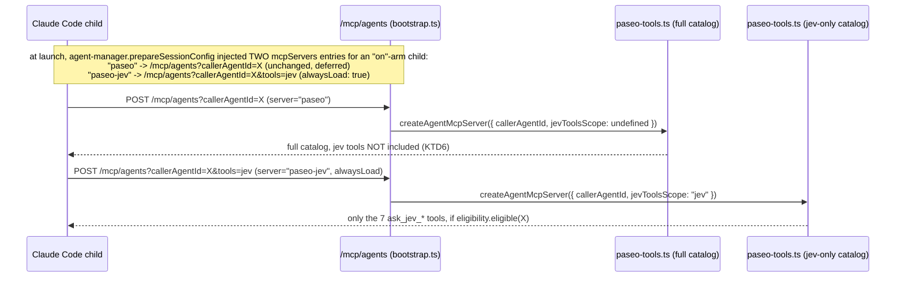

# fix: JEV spawn hint never raises price, and "on"-arm agents get JEV's file tools up front

**Target repo:** paseo (worktree `~/paseo-worktrees/jev-fixes-2`, branch `fix/jev-integration-2`, off `fix/jev-integration` @ 66301711f)

Origin: `~/bozeo-ops/briefs/jev-integration-fixes-2.md`, grounded in `~/bozeo-ops/reviews/jev-integration-audit.md`. Both already read; this plan does not repeat their findings, only the decisions that follow from them.

**Product Contract preservation:** no prior Product Contract exists for this plan (direct bootstrap from a fully-specified ops brief). Both items' decisions are session-settled by Tyler (2026-10-16), carried as labeled KTDs below.

---

## Problem Frame

Two independent defects in the `fix/jev-integration` JEV rollout, found by the audit and already decided by Tyler:

1. **Spawn hint can still raise price.** `agents.jev.spawnHint.applyHard` is off (no upward task-class moves), but `applyRole` is on, and a JEV-proposed role can pick a pricier model via the role's own pool — bypassing the class-rank-based `move` field entirely, since `move` only compares task-class rank, never the actual model cost. The audit measured −37.9M weighted tokens of this in 7 days, and it never reaches the shadow evidence gate.
2. **JEV's 7 `ask_jev_*` file-judging tools are invisible.** They reach the "on"-arm child's MCP catalog, but Claude Code defers MCP tool schemas behind an explicit `ToolSearch` call once the daemon's combined MCP tool descriptions exceed context's auto-defer threshold, and the one-sentence discovery hint already injected into `appendSystemPrompt` (`plugins/claude-account-pool/shared/jev-tools-hint.ts`, wired `fdb6c05cf`) has produced zero `ToolSearch` calls and zero tool calls across hundreds of eligible sessions in 7 days.

## Requirements

- **R1 (clamp).** When JEV's spawn hint changes a create's task class or role, the classifier keeps that effect only if the resulting model's weight (`priceWeight`, the same table `priceSpawnHint` prices against) is no higher than the model the create would get without JEV. Otherwise the no-JEV model runs. Tools are never affected by this clamp (D2 already holds tools off the JEV-influenced role).
- **R2 (clamp visibility).** The clamp is visible on `AgentDecision.jev` so a shadow/live day can count how often JEV wanted to go up and was held.
- **R3 (eager tools).** "On"-arm children (`paseo.jev-tools: on`) get the 7 `ask_jev_*` tools loaded into their tool list from the first turn, not behind `ToolSearch`. The hold-out ("control") arm is untouched — it already gets no JEV tools at all (`JevToolsEligibility.eligible` is false for it), so there is nothing to change for it beyond not regressing that.
- **R4 (hint text).** The "on"-arm system-prompt hint is rewritten to match: the tools are already present, so the hint is an instruction to use them (before reading a file over ~8K tokens or scanning a directory, ask first) rather than an instruction to go find them.
- **R5 (Codex).** State whether Codex children can get these tools at all today, and whether eager loading would apply to them.
- **R6.** D8's cost log (`jev-tool-use-log.ts`) and kill rule (`scripts/jev-tools-ab.ts`) keep working unchanged.

## Scope Boundaries

**Out of scope:**

- Any other audit finding not named in the brief (awayReply presence scoping, remediationTriage wording, readCheck reread signal, dashboard visibility, feature 9's promotion rule). These are separate, undecided items.
- App/dashboard UI changes to surface the new clamp flag visually. The brief's own Tests section asks only for classifier-level coverage; the flag lands in the decision/savings record so a future UI pass can read it. Noted as deferred in the final report.
- The retroactive `move:none`-undercounting fix the audit also flagged (−37.9M of role-driven swaps not counted as `changed`) — already fixed on this branch (`3a36432eb`, before this plan's base commit). Nothing to do here.

### Deferred to Follow-Up Work

- Surfacing the clamp (and JEV tool usage) in `app/jev.tsx`'s dashboard tiles/table.

## Key Technical Decisions

**KTD1 — Clamp by comparing final models, not by re-deriving "would this be an upward move" from task-class rank.** _(session-settled: user-directed — chosen over extending the `move: "down"|"up"|"none"` rank comparison to cover roles too: rank-based comparison only orders task classes, which is the exact mechanism that let role-driven swaps slip through `move:none` in the first place; comparing the two fully-resolved models' price weights is the one calculation that is correct regardless of whether class, role, or both moved it.)_ `plugins/claude-account-pool/server/classifier.ts`'s `classifyAgent` already computes a "no-JEV" baseline role and task class for its `decideJevRecord` wouldBe/base reporting (`jevlessRole`, `resolveTaskClass(textInput).taskClass`); this plan promotes that same baseline to also gate the _actually applied_ model, before it is used for account/thinking/output-style/mcp decisions — so a clamp changes nothing downstream except which model string those other decisions see.

**KTD2 — The clamp touches only the model field.** _(session-settled: user-directed — "Otherwise, take the no-JEV model while keeping whatever role and tool decisions don't change the model.")_ `roleDecision` and `taskClass` keep reporting JEV's answer (for audit/display and the existing `hintNote`/hint text); only the `model` variable fed into `decideAccount`/`decideThinking`/`decideOutputStyle`/`decideJevTools` is swapped to the no-JEV model when clamped. Tools/MCP are already sourced from the jevless role unconditionally (D2, pre-existing), so they need no new clamp logic.

**KTD3 — Record the clamp as a boolean flag on `JevHintDecision`, not a new `move` value.** _(session-settled: user-directed — brief offered either `move:"clamped-up"` or a flag; a flag is chosen.)_ `wouldBe.move` is parsed with a closed check (`move !== "down" && move !== "up" && move !== "none") return null` in `savings-spawn.ts`) and is a hypothetical-always-applied signal independent of whether live mode actually applied it — conflating "JEV would have gone up" with "and live mode held it back" into one field loses the first signal for shadow-mode days where nothing is ever held back (shadow never applies anything). A new `modelClamped: boolean` field is additive to the wire format and the decision type, so every existing consumer (`decision-log.ts`, `role-router.ts`'s `formatJevSpawnLabel`, `savings-spawn.ts`'s parser) keeps working unchanged; they're extended to carry the flag through, not rewritten.

**KTD4 — Eager-load via a second, minimal MCP server with `alwaysLoad: true`, not by flipping `alwaysLoad` on the existing `paseo` server.** _(session-settled: user-directed — "If eager loading isn't possible for one MCP server alone... pick the next best: for example, put the JEV tools on their own small MCP server."; researched and confirmed necessary, not just the fallback.)_ The installed Claude Code CLI (2.1.301) supports `alwaysLoad` as a per-MCP-server config flag (`"Added alwaysLoad option to MCP server config — when true, all tools from that server skip tool-search deferral"`, changelog) and MCP tool-search auto-defer is based on total MCP tool-description size across all configured servers, not a per-tool opt-in. The existing internal `paseo` MCP server (`/mcp/agents`) carries the entire ~100+-tool catalog in one `McpServer` instance; setting `alwaysLoad` there would eager-load the whole catalog for every "on"-arm agent, which defeats the reason tool-search deferral exists. A second server exposing only the 7 `ask_jev_*` tools, requested only for "on"-arm children, keeps the eager-load blast radius to exactly the tools this plan is about.

- `McpServerConfig`'s http/sse/stdio variants already carry an optional `alwaysLoad?: boolean` field in `packages/server/src/server/agent/agent-sdk-types.ts:32,46,60` — no type change needed there.
- The tool list is decided at spawn (from the agent's pinned `paseo.jev-tools` label) and never changes mid-session, so this does not touch the prompt-cache-breaks-on-change risk the audit flagged for _mid-life_ eager loading.

**KTD5 — Same physical route, a second query parameter, not a new HTTP route.** _(Agent-derived, consistent with the brief's "find how to make these tools load up front" research instruction.)_ `/mcp/agents` already branches its built catalog per request on a `callerAgentId` query parameter (`bootstrap.ts`'s `runAgentMcpRequest`); adding a sibling `tools=jev` query parameter and threading it through `createAgentMcpSession` → `createAgentToolHostDependencies` → `createAgentMcpServer` reuses the existing auth (`isAgentMcpRequestAuthorized`), transport, and eligibility-priming path verbatim, rather than standing up new route registration, a new self-authenticating-route entry (`auth.ts`'s `SELF_AUTHENTICATING_ROUTES`), and new tests for all of that.

**KTD6 — Drop jev-tool registration from the main catalog once the dedicated server exists.** _(Agent-derived.)_ `JevToolsEligibility.eligible()` is already exactly the "on"-arm, Read-allowed, D7-ok population (`hasJevToolsLabel` checks the label is `"on"`; `decideJevTools` never marks a "control"-arm or ineligible create eligible) — the same population that will receive the new dedicated server. Leaving the old `if (options.jevTools && callerAgentId) { ...registerJevTools(...) }` block in the main catalog builder (`paseo-tools.ts:~1368-1406`) would duplicate the 7 tools under two MCP server names (`mcp__paseo__ask_jev_*` and `mcp__paseo-jev__ask_jev_*`) for every "on"-arm agent. Removing that block and registering JEV tools only inside the new `tools=jev`-scoped server keeps one tool identity per name.

**KTD7 — Codex gets neither today, and nothing here changes that.** _(session-settled: user-directed — "Codex children: say whether they get these tools at all.")_ `decideJevTools` already refuses every non-Claude-family create outright (`providerFamily !== POOL_FAMILY`) because both the MCP session and the discovery hint ride on Claude-only mechanisms (`providerOptions.appendSystemPrompt` is rejected by other providers' strict schemas). This is unconditional on arm, so eager loading is moot for Codex: there is no tool exposure to make eager. No code change; state this plainly in the final report and in the docs update.

---

## High-Level Technical Design

### Item 1 — clamp flow inside `classifyAgent`

```
roleDecision, jevlessRole  = resolve role (JEV-influenced if applyRole)   [unchanged]
classResolution, wouldBeClass = resolve task class (JEV-influenced if applyHard)  [unchanged]
hintChangedModel = classResolution.source === "jev" || roleDecision.source === "classified-jev"

jevModel = decideModel(role=roleDecision.role, class=taskClass.taskClass)   [same call as today]
model = jevModel
modelClamped = false

if hintChangedModel:
    baselineClass = resolveTaskClass(textInput).taskClass            # same calc decideJevRecord already does
    baselineRole  = jevlessRole ?? roleDecision
    noJevModel = decideModel(role=baselineRole.role, class=baselineClass)
    wJev  = priceWeight(jevModel.model)
    wBase = priceWeight(noJevModel.model)
    if wJev != null && wBase != null && wJev > wBase:
        model = noJevModel
        modelClamped = true

tools, account, thinking, outputStyle, mcp, jevTools = ...(model)...  [unchanged calls, now see the clamped model when clamped]
decision.jev = decideJevRecord(..., modelClamped)                      # new param, sets JevHintDecision.modelClamped
```

Unresolvable weights (`priceWeight` returns `null` for an unrecognized model id) never clamp — same "can't price it, don't guess" posture `priceSpawnHint` already takes.

### Item 2 — tool catalog request shape



A "control"-arm or ineligible child never gets the second `mcpServers` entry at all (`withRuntimeJevToolsMcpServer` is a no-op unless the label reads `"on"`), so its `/mcp/agents?callerAgentId=X` request is unchanged end-to-end — no behavior change for the hold-out arm.

---

## Implementation Units

### U1. Shared price-weight table moves to `packages/protocol`

**Goal:** Give the classifier plugin (which cannot depend on `packages/server`) access to the exact same model-weight table `priceSpawnHint` uses, per R1/KTD1.

**Requirements:** R1

**Dependencies:** none

**Files:**

- `packages/protocol/src/jev/pricing.ts` — add `JEV_PRICE_WEIGHTS`, `normalizeSavingsModel`, `priceWeight` (moved verbatim from `savings-formulas.ts`, same doc comments, same `JEV_PRICE_WEIGHTS` table and `WEIGHT_NOTE`-adjacent "w: Opus 5.5 1, Opus 5 1.25, Sonnet 0.5, Haiku 0.25" framing kept in `savings-formulas.ts`'s own `WEIGHT_NOTE` constant, untouched).
- `packages/server/src/server/jev/savings-formulas.ts` — replace the local definitions with a re-export (`export { JEV_PRICE_WEIGHTS, normalizeSavingsModel, priceWeight } from "@getpaseo/protocol/jev/pricing.js";`) so every existing call site (`priceSpawnHint` and five others) keeps working unchanged.
- `packages/protocol/src/jev/pricing.test.ts` (new) — move/duplicate the existing weight-table unit coverage from wherever `savings-formulas.test.ts` currently tests `priceWeight`/`normalizeSavingsModel` (check first; if none exists today, add minimal coverage here).

**Approach:** Pure relocation, no behavior change. `packages/protocol` already hosts `usdToOpusTokens`/`opusTokensToUsd` for the identical reason ("Shared by the daemon's formulas and the app's dashboard, so the two never disagree") — this is the same shape of sharing, now with a third consumer (the plugin).

**Patterns to follow:** `packages/protocol/src/jev/pricing.ts`'s existing doc-comment voice; `savings-formulas.ts`'s existing `priceWeight`/`normalizeSavingsModel` implementations (move as-is).

**Test scenarios:**

- `normalizeSavingsModel` strips a `[1m]` suffix, a vendor path prefix, a bedrock/vertex ARN-style prefix, and a date suffix (mirrors any existing test; if none exists, write one case per transform).
- `priceWeight` returns the documented weight for each of the 5 known model ids and `null` for an unrecognized one.
- `Test expectation` for the re-export in `savings-formulas.ts`: none beyond the existing `savings-formulas.test.ts` suite continuing to pass unchanged (no new test needed there — it's exercising the same function through a re-export).

**Verification:** `npx vitest run packages/protocol/src/jev/pricing.test.ts packages/server/src/server/jev/savings-formulas.test.ts` (if the latter exists) both green; `npm run typecheck` clean across `protocol`, `server`, and the `claude-account-pool` plugin.

---

### U2. Classifier clamps a pricier JEV-driven model to the no-JEV model

**Goal:** Implement R1/R2 — `classifyAgent` never lets the hint's role or class choice land on a pricier model than the no-JEV baseline; record that it happened.

**Requirements:** R1, R2 (KTD1, KTD2, KTD3)

**Dependencies:** U1

**Files:**

- `plugins/claude-account-pool/server/classifier.ts` — restructure the `model`/`decideJevRecord` section of `classifyAgent` (around the existing `const model = decideModel(...)` call) per the High-Level Technical Design above; extend `JevHintDecision` with `modelClamped: boolean`; extend `decideJevRecord`'s signature to accept the clamp flag; always compute `jevlessRole` when a hint exists (not only when `resolution.match === "jev"`), since the clamp check needs the baseline role regardless of which path produced the price difference.
- `plugins/claude-account-pool/server/classifier.test.ts` — add the three scenarios below.
- `plugins/claude-account-pool/server/decision-log.ts` — `describeJev` gains the clamp flag in its logged fields (mirror how `declaredAudit`/`applied` are already surfaced).
- `plugins/claude-account-pool/server/decision-summary.ts` — the human-readable `JEV spawn hint: ...` line notes when a would-be raise was held, e.g. appending `" (held: would have cost more)"` when `modelClamped`.
- `plugins/claude-account-pool/server/role-router.ts` — `formatJevSpawnLabel` appends `clamped=${jev.modelClamped ? 1 : 0}` to the `v1;...` wire string.
- `packages/server/src/server/jev/savings-spawn.ts` — `JevSpawnLabel` gains `clamped: boolean`; `parseJevSpawnLabel` reads the new field, defaulting to `false` when absent (same "a label written before this field existed carries none of it" precedent as `audit`); the recorded `facts` in `createSpawnHintSavingsRecorder.onAgent` carries `clamped: spawn.clamped` alongside the existing fields, for future reporting — no change to `priceSpawnHint`'s pricing formula itself (pricing already prices whatever `runningModel` actually is, which is now correctly the clamped model when clamped).

**Approach:** See High-Level Technical Design, item 1. Key invariant to preserve: `tools`, `mcp`, and the non-model parts of `roleDecision`/`taskClass` are computed exactly as before this unit — only the local `model` binding used for `decideAccount`/`decideThinking`/`decideOutputStyle`/`decideJevTools` changes identity when clamped.

**Patterns to follow:** `decideJevRecord`'s existing `wouldBeModel`/`baseModel` computation (same `decideModel` call shape, same `baselineClass`/`jevlessRole ?? roleDecision` baseline pattern) — this unit promotes that exact baseline to also gate the real decision rather than only the reported one.

**Test scenarios (in `classifier.test.ts`):**

- **Upgrade clamped:** a create where `applyRole` resolves a JEV-proposed role whose model pool picks a pricier model (e.g. sonnet → opus) than the no-JEV role's model — assert `decision.model.model` equals the no-JEV model, `decision.jev.modelClamped === true`, and `decision.jev.wouldBe.model` still reports JEV's (unclamped) proposed model (the hypothetical field is untouched by the clamp, per KTD3).
- **Downgrade applied:** a create where the JEV-proposed role/class picks a cheaper model (e.g. sonnet → haiku) — assert `decision.model.model` equals the JEV model (not clamped), `decision.jev.modelClamped === false`.
- **Tools unchanged by the clamp:** same upgrade-clamped setup as above, but assert `decision.tools` (denied/allowed list) and `decision.mcp` are byte-identical to a create with no JEV hint at all for the same role/class inputs — i.e., clamping the model never touches D2's tool guarantee, which already held before this unit (regression guard, not new behavior).
- **No weight for one side skips the clamp:** a create whose JEV-proposed model isn't in `JEV_PRICE_WEIGHTS` (custom/unlisted model) — assert `modelClamped === false` and the JEV model still runs (can't price, don't guess, matching `priceSpawnHint`'s own null-weight posture).
- **Shadow mode never clamps anything it would apply:** a shadow-mode hint (nothing applies regardless) — assert `modelClamped === false` (clamp logic only engages when `hintChangedModel` is true, which requires `live`, matching `resolution.match === "jev"`'s existing shadow-mode behavior of never actually resolving to the JEV role/class).

**Verification:** `npx vitest run plugins/claude-account-pool/server/classifier.test.ts --bail=1`; `npm run typecheck`; `npm run lint -- plugins/claude-account-pool/server/classifier.ts plugins/claude-account-pool/server/decision-log.ts plugins/claude-account-pool/server/decision-summary.ts plugins/claude-account-pool/server/role-router.ts packages/server/src/server/jev/savings-spawn.ts`.

---

### U3. Wire-format and decision-log coverage for the clamp flag

**Goal:** Lock in U2's new field across the label parser and decision log so a shadow/live day's data is trustworthy, per R2.

**Requirements:** R2

**Dependencies:** U2

**Files:**

- `plugins/claude-account-pool/server/role-router.test.ts` (or wherever `formatJevSpawnLabel` is already tested) — round-trip a clamped decision through `formatJevSpawnLabel` → `parseJevSpawnLabel` and assert `clamped` survives.
- `packages/server/src/server/jev/savings-spawn.test.ts` — assert a label with no `clamped=` field (written before this change) parses with `clamped: false`, and a label with `clamped=1` parses `clamped: true`; assert `onAgent`'s recorded `facts.clamped` matches.
- `plugins/claude-account-pool/server/decision-log.test.ts` — assert `describeJev` includes the clamp flag.

**Approach:** Mechanical extension of existing round-trip tests; no new behavior beyond U2's.

**Patterns to follow:** The existing `audit` field's round-trip test (same file, same shape) — `clamped` follows the identical "added later, absent means false" contract.

**Test scenarios:** covered above; this unit is the test-writing counterpart to U2's wire-format changes (kept separate only because it touches different test files than U2's primary classifier coverage — merge into U2's commit if the implementer finds that cleaner, since both land in the same commit per the one-commit-per-item constraint).

**Verification:** `npx vitest run plugins/claude-account-pool/server/role-router.test.ts packages/server/src/server/jev/savings-spawn.test.ts plugins/claude-account-pool/server/decision-log.test.ts --bail=1`.

_(U1–U3 are one commit: "fix(jev): hold a spawn hint to no more than the no-JEV model's price".)_

---

### U4. Dedicated eager-load MCP server for JEV's file tools

**Goal:** Implement R3/R4/R6 — "on"-arm children get the 7 `ask_jev_*` tools loaded up front via a second, small, `alwaysLoad` MCP server; everyone else is unaffected.

**Requirements:** R3, R4, R6 (KTD4, KTD5, KTD6)

**Dependencies:** none (independent of U1–U3)

**Files:**

- `packages/server/src/server/agent/runtime-mcp-config.ts` — add `PASEO_JEV_MCP_SERVER_NAME = "paseo-jev"`, `PASEO_JEV_MCP_QUERY = "tools=jev"`-style pathname+query matcher, `stripJevToolsMcpServer`, and `withRuntimeJevToolsMcpServer(params: { config, agentId, mcpBaseUrl, mcpAuthToken, enabled })` mirroring `withRuntimePaseoMcpServer`'s shape exactly, except the injected entry carries `alwaysLoad: true` and the URL appends `&tools=jev`; a no-op (byte-identical passthrough after stripping any stale stored entry) when `enabled` is false, matching `withRuntimeMcpGatewayServers`'s `!params.enabled` short-circuit.
- `packages/server/src/server/agent/agent-manager.ts` — in `prepareSessionConfig`, call `withRuntimeJevToolsMcpServer` alongside the existing `withRuntimePaseoMcpServer` call, with `enabled: labels?.[JEV_TOOLS_LABEL] === "on"` (import `JEV_TOOLS_LABEL` from `@getpaseo/protocol/agent-labels`, already used elsewhere in this file's neighborhood — confirm import path).
- `packages/server/src/server/bootstrap.ts` — in `runAgentMcpRequest`, parse a sibling `req.query.tools` the same defensive way `callerAgentId` is parsed (string or first-of-array), and pass it through `createAgentMcpSession(callerAgentId, toolsScope)`.
- `packages/server/src/server/agent/tools/paseo-tools.ts` — `createAgentToolHostDependencies`/`createAgentMcpServer` accept a new `jevToolsScope?: "jev"` option; when set, build a server containing only the JEV tools (still gated on `jevTools.eligibility.eligible(callerAgentId)`, same as today — belt-and-suspenders even though launch-time `enabled` already restricts who gets this URL at all); when unset, keep today's full catalog minus the old inline jev-registration block (KTD6 — delete the `if (options.jevTools && callerAgentId) { ...registerJevTools(...) }` block from the full-catalog path entirely, since it is now dead code covered by the `jevToolsScope === "jev"` branch for the only population that was ever eligible).
- `packages/server/src/server/agent/runtime-mcp-config.test.ts` — new/extended coverage below.
- `packages/server/src/server/agent/tools/paseo-tools.test.ts` (or wherever the catalog builder is tested) — assert the `jevToolsScope: "jev"` server contains exactly the 7 `ask_jev_*` tool names and nothing else; assert the default-scope server no longer contains them.

**Approach:** See High-Level Technical Design, item 2, for the full request-shape sequence. `alwaysLoad: true` is already a valid field on `McpHttpServerConfig` (`agent-sdk-types.ts:46`) — no type change.

**Technical design (directional):**

```ts
// runtime-mcp-config.ts, parallel to withRuntimePaseoMcpServer
export function withRuntimeJevToolsMcpServer(params: {
  config: AgentSessionConfig;
  agentId: string;
  mcpBaseUrl: string | null;
  mcpAuthToken: string | null;
  enabled: boolean;
}): AgentSessionConfig {
  const storedConfig = stripJevToolsMcpServer(params.config);
  if (!params.enabled || !params.mcpBaseUrl) return storedConfig;
  return {
    ...storedConfig,
    mcpServers: {
      [PASEO_JEV_MCP_SERVER_NAME]: {
        type: "http",
        url: `${params.mcpBaseUrl}?callerAgentId=${params.agentId}&tools=jev`,
        alwaysLoad: true,
        ...(params.mcpAuthToken
          ? { headers: { Authorization: `Bearer ${params.mcpAuthToken}` } }
          : {}),
      },
      ...storedConfig.mcpServers,
    },
  };
}
```

**Patterns to follow:** `withRuntimePaseoMcpServer`/`stripInternalPaseoMcpServer` (same file) for the inject/strip pair shape; `withRuntimeMcpGatewayServers`'s `!params.enabled` early-return for the disabled case.

**Test scenarios:**

- **"On"-arm config carries the eager server:** `withRuntimeJevToolsMcpServer({ enabled: true, ... })` produces a `paseo-jev` entry with `alwaysLoad: true` and `&tools=jev` in its URL.
- **Hold-out/ineligible config carries nothing:** `enabled: false` returns the config with no `paseo-jev` entry (and strips a stale one if present from a prior label state, mirroring the gateway helper's persistence-safety behavior).
- **`prepareSessionConfig` gates on the live label, not a stale one:** an agent whose labels carry `paseo.jev-tools: on` gets both `paseo` and `paseo-jev` entries; one without the label (or with `control`) gets only `paseo`.
- **Bootstrap request routing:** `?callerAgentId=X&tools=jev` builds the jev-only catalog (name list is exactly the 7 tools); `?callerAgentId=X` with no `tools` param builds the full catalog with no `ask_jev_*` names in it.
- **Eligibility still gates the dedicated server's content:** a request to the `tools=jev` URL for an agent `JevToolsEligibility.eligible()` returns false for (e.g., Read denied, D7 excluded) gets an empty tool list, not an error — mirrors today's `catch`-and-withhold behavior in the main catalog path.
- **D8 untouched:** `jev-tool-use-log.ts`'s recording and `scripts/jev-tools-ab.ts`'s kill-rule read path are exercised by at least one of the above through an actual tool call in test, or explicitly noted as `Test expectation: none -- D8's recorder reads tool-use records, not which MCP server delivered the schema; no behavior there changes` if a full call-through fixture is disproportionate to write here.

**Verification:** `npx vitest run packages/server/src/server/agent/runtime-mcp-config.test.ts packages/server/src/server/agent/agent-manager.test.ts packages/server/src/server/agent/tools/paseo-tools.test.ts --bail=1` (scope to whichever of these already exist and cover the touched functions — do not invent a full suite run); `npm run typecheck`; `npm run build:server` (cross-package: `protocol` types feed `server`, and this unit also touches `agent-manager.ts`/`bootstrap.ts`, which depend on `protocol`'s label export already in use elsewhere in those files).

---

### U5. Rewrite the "on"-arm hint now that the tools are already loaded

**Goal:** R4 — the hint stops telling the agent to go find tools it already has, and becomes a short, concrete usage rule.

**Requirements:** R4

**Dependencies:** U4 (the hint's premise — "you have these tools, not you must search for them" — depends on eager loading actually landing first; land in the same commit as U4 since both are part of "making eager loading real")

**Files:**

- `plugins/claude-account-pool/shared/jev-tools-hint.ts` — rewrite `JEV_TOOLS_DISCOVERY_HINT` (rename if the implementer judges the old name misleading now that nothing is "discovery" anymore — e.g. `JEV_TOOLS_USAGE_HINT`; keep the export name stable if that churns too many call sites for no behavioral gain — implementer's call, not product-visible either way) to: state the 7 tool names once, and give the one concrete trigger rule from the brief — before reading a file over ~8K tokens, or before scanning a directory to find something, ask JEV first via the `ask_jev_*` tools, and open the file only if the answer says to. One short paragraph, same as today's length budget. No change to how/where it's injected (still `appendSystemPrompt`, still "on" arm only, still beside the restriction notice) — `role-router.ts`'s `enforceToolDecision` wiring is untouched.
- `plugins/claude-account-pool/server/role-router.test.ts` (or a dedicated hint test, if one exists for the old constant) — assert the hint text appears in an "on"-arm create's computed `appendSystemPrompt` and is absent for a "control"-arm or ineligible create (this is very likely already covered for the old hint text by the `fdb6c05cf` commit's own tests — extend, don't duplicate, if found).

**Approach:** Text-only change plus the rename judgment call above. D1 constraint: the new text must not introduce a confirmation step or block anything — it is advisory phrasing ("ask JEV first... open the file only if the answer says to"), same register as the existing hint, not a hard gate enforced in code.

**Patterns to follow:** The existing `JEV_TOOLS_DISCOVERY_HINT` doc comment's voice and the file's existing one-paragraph budget.

**Test scenarios:**

- Hint text present verbatim in `appendSystemPrompt` for an "on"-arm create.
- Hint text absent for a "control"-arm create and for a create with no `jevTools` decision at all.
- `Test expectation: none -- D1` for "does it block or confirm": this is a documentation-only guarantee (the hint is plain text appended to a prompt, not an enforcement mechanism), not something a unit test can assert beyond "the text itself contains no confirmation language," which is a one-time human read of the new copy, not an automated check.

**Verification:** `npx vitest run plugins/claude-account-pool/server/role-router.test.ts --bail=1` (or the specific hint test file, if separate); `npm run format -- plugins/claude-account-pool/shared/jev-tools-hint.ts`.

_(U4–U5 are one commit: "fix(jev): eager-load the file-judging tools for the on arm instead of hinting at ToolSearch".)_

---

### U6. Docs

**Goal:** `docs/jev.md` and the classifier's own file-header doc comment describe the clamp and the eager-load mechanism as what JEV may actually do today, per the brief's explicit ask.

**Requirements:** R1–R5 (documentation of all of the above)

**Dependencies:** U2, U4 (docs describe landed behavior, not planned behavior)

**Files:**

- `docs/jev.md` — Feature 2 (spawn hint) section: add the clamp rule (JEV may only move price down; an up-move from role or class is held at the no-JEV model, flagged `modelClamped`) next to wherever the section currently describes `applyHard`/`applyRole`. Features 4–6 (agent tools) section: replace the "deferred behind ToolSearch, discovery hint" description with "eager-loaded via a dedicated MCP server for the on arm; Codex never gets these tools regardless" (KTD7) — update the "Which agents get them" subsection the audit cited.
- `plugins/claude-account-pool/server/classifier.ts` — the file-header doc comment block (the one the audit's "D2" reference and `## Inference may choose a model; it may never remove` section live in, around line 80-110) gains one short clause: inference may also never make a create's model _pricier_ than the no-hint baseline.
- `docs/mcp-gateway.md` or `docs/plugins.md` — **only if** either doc already describes the internal `paseo` MCP server's shape in a way the new `paseo-jev` sibling would contradict if left undocumented; otherwise skip (per CLAUDE.md "one fact, one doc" — `runtime-mcp-config.ts`'s own doc comments are likely sufficient and this may be unnecessary; implementer confirms by reading both docs before deciding).

**Approach:** Integrate into the existing sections per CLAUDE.md's doc-writing rules (find the doc that owns the subject, rewrite the part that's wrong — don't append a new paragraph at the bottom). Plain, short, second person, no "it's not X, it's Y" constructions.

**Test scenarios:** `Test expectation: none -- docs only.`

**Verification:** Read back the edited `docs/jev.md` sections once for the doc-voice rules (no "honest"/"robust"/"seamless"/"simply"/"just", no throat-clearing); `npm run format:files -- docs/jev.md` if Biome/Prettier covers markdown in this repo (check `npm run format` scope first — skip if markdown isn't formatted by that script).

_(U6 is its own commit only if the brief's "one commit per item" is read as two implementation commits plus a docs commit; more likely docs land folded into U1–U3's and U4–U5's commits respectively, split by which item each doc change describes. Implementer's call — the brief's hard constraint is "one commit per item," and docs are part of each item's own commit.)_

---

## Risks & Dependencies

- **Cross-package import (U1):** the `claude-account-pool` plugin does not list `@getpaseo/protocol` in its own `package.json` `devDependencies`, but its test files already import _type-only_ members from `@getpaseo/protocol/jev/rpc-schemas` successfully today, confirming the workspace resolves it. This plan imports a _runtime_ value (`priceWeight`) from the same package for the first time in this plugin's non-test code — if `npm run typecheck`/`vitest` for the plugin fails to resolve it, add `@getpaseo/protocol` to the plugin's `package.json` `devDependencies` (workspace version, matching how other workspace packages reference it) rather than duplicating the table.
- **U4's cross-package build order:** `agent-manager.ts` and `bootstrap.ts` already depend on `packages/protocol`'s `agent-labels` export elsewhere in the same files, so no new dependency edge — but per CLAUDE.md, rebuild `packages/protocol`/`packages/server` declarations (`npm run build:server`) before diagnosing any cross-package type error in this unit.
- **D8 kill-rule risk:** if the "on" arm's effective tool-call rate changes sharply once tools are actually visible, `scripts/jev-tools-ab.ts`'s kill rule is the existing safety valve — this plan does not touch its thresholds, only makes the "on" arm's tools reachable the way the experiment always intended.

## Verification Contract

- `npm run build:server` once, first (fresh worktree, per the brief's constraint), run through `~/bozeo-ops/cpu-policing/heavy.sh`.
- Per unit, the `npx vitest run <touched files> --bail=1` commands listed above, each wrapped in `heavy.sh`, run from the owning package directory.
- `npm run typecheck` and `npm run lint -- <touched files>` after each item's changes, not once at the end.
- `npm run format` before each commit.
- No full-suite run, no e2e run (rapid mode, repo-wide rule).

## Definition of Done

- U1–U3 land in one commit; U4–U5 land in one commit; each ends with `Co-Authored-By: Claude Opus 5.5 <noreply@anthropic.com>`.
- `docs/jev.md` and the classifier's file-header comment reflect both changes.
- Targeted vitest files for every touched module pass; `npm run typecheck` and `npm run lint` are clean on touched files.
- Neither commit is pushed. No `--no-verify`. No `git stash` used anywhere (a scratch `git worktree add --detach` instead, if a base-vs-after comparison is needed).
- Final report covers, per item: what was built, how eager loading works (or precisely why it couldn't, if U4 turns out infeasible during implementation), tests and their results, then the two commits and anything deferred (app dashboard UI for the clamp flag, the Codex non-applicability note, any docs file skipped per U6's "only if" clause).
