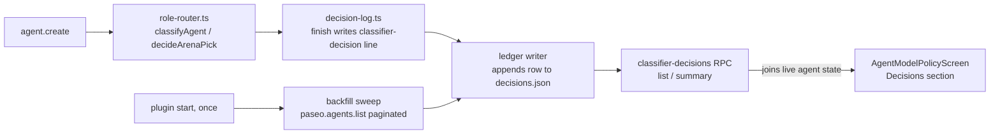

# feat: Classifier decisions dashboard, so Tyler can judge arena shadow mode

**Target repo:** paseo (worktree `/Users/tylerthackray/.paseo/worktrees/3jvw4yw6/classifier-dashboard`, branch `feat/classifier-dashboard`, off `origin/multi-account-orchestrator` @ 08d9405a2)

Origin: `~/bozeo-ops/briefs/classifier-dashboard.md`, written from Tyler's 2026-10-20 ask ("i want some kind of dashboard for the classifier that shows me what its doing so i can judge the shadwed mode performance"). This plan does not repeat the brief's findings, only the decisions that follow from them.

**Product Contract preservation:** no prior Product Contract exists for this plan (direct bootstrap from a fully-specified ops brief). The brief's ten "Defaults" are brief-directed decisions, not open questions; each is carried below as a KTD or an implementation unit, with the file-level research that confirms or adjusts it.

---

## Problem Frame

The arena-ranking classifier (`docs/arena-ranking.md`) has been running in shadow mode for 10 days. 280 agents carry a would-be pick (`paseo.arena-pick`, all `applied=0`); nobody can see the picks except by grepping a daemon log that rotates (today's log holds 13 lines). Tyler cannot judge whether flipping `arena.shadow` to `false` is a good idea without a way to see what the classifier would have done and how the agents that actually ran turned out.

This plan adds a durable decisions ledger and a read-only dashboard on the account-pool plugin's existing settings screen. It does not add the live-mode toggle (brief default 1) and does not change `decideArenaPick` or `decideModel` behavior.

## Requirements

- **R1 (durable history).** Every classifier decision that reaches a `"ranked"` or `"fallback"` arena outcome is written to a bounded, durable ledger at the same point `decision-log.ts` writes its daemon-log line, so history survives log rotation and a daemon restart.
- **R2 (backfill).** The 280+ historical picks already sitting in agent record labels are backfilled into the ledger once, so the dashboard has a usable history on day one. Backfilled rows are marked as such, since they carry no fallback reason and no decision-time snapshot (title, class, thinking, mcp) beyond what the label captured.
- **R3 (row content).** Each ledger row, joined live with current agent state, shows: time, agent title (opens the agent), role, task class, work kind, the model that actually ran, the arena would-be pick (board, tier, proxy, applied), agree/disagree, the fallback reason when there was no pick, and an outcome (final state, completion state, a failover-moved flag).
- **R4 (summary).** The dashboard's top section shows: agreement rate; would-be pick distribution by model and by tier; fallback reasons by count; the same splits by work kind; and, per model actually run, outcome rates by work kind — the only real performance evidence, since a would-be pick never ran. A one-line caveat says so on screen.
- **R5 (filters).** Disagreements-only, by role, by work kind.
- **R6 (platforms).** Desktop (macOS and Windows, Electron), web, and phone — compact layout on phone, per `docs/design.md`'s responsiveness section and CLAUDE.md's platform gates.
- **R7 (placement).** Lives on the account-pool plugin's existing "Agent Model Policy" settings screen, not a new top-level screen (ui-reuse-first).
- **R8 (alias gap).** `shared/arena-aliases.ts`'s Sonnet 5.5 coverage is checked against live rankings data and fixed if it is genuinely missing a mapping — this decides whether Sonnet 5.5 can ever be arena-ranked.
- **R9 (protocol).** The new plugin RPC follows the plugin's own `defineRpc` pattern (dotted-kebab name, Zod input/output), not a new core protocol message.
- **R10 (tests).** Pure aggregation functions unit-tested; ledger cap and backfill tested with a temp `PASEO_HOME`; no plugin-client browser test (none exists today for this plugin — see U6); never the full suite.

## Scope Boundaries

**In scope:** the ledger, the backfill, the read-only dashboard section, the alias check, doc updates.

**Out of scope / non-goals:**

- The live-mode toggle (`arena.shadow: false`) — brief default 1, explicit.
- Changing `decideArenaPick`, `decideModel`, or any ranking behavior.
- A new top-level app screen.
- A new core-protocol (`*.request`/`*.response`) RPC — this stays a plugin RPC.

### Deferred to Follow-Up Work

- **Per-agent token/cost in the Outcome row.** `docs/usage-history.md` stores exactly this (`$PASEO_HOME/usage-history/agents/{agentId}.json`, cost-weighted spend), but it is reached through the core `usage.history.get` RPC, and the plugin's sanctioned client surface (`PluginHandlerContext.paseo`, backed by `@getpaseo/client`'s `PaseoApi`) has no usage-history method — confirmed by grep, nothing matches `usageHistory` in `packages/client/src/index.ts`. Reading that file directly from the plugin would cross a store-ownership boundary `docs/data-model.md`'s "Store Surface Rules" warns against (the file's schema and bounds are owned by `packages/server/src/server/usage-history/usage-history-store.ts`, not this plugin). Deferred: either the plugin SDK grows a read-only usage-history accessor, or this waits for a future pass. Not in this plan's units.
- **Full failover move history** (count, timestamps, reasons per move). No structured API returns this — only the `paseo.account-failover.migrated-to` label's presence/chain (`followMigratedTo`, `packages/protocol/src/agent-labels.ts`). The Outcome row uses the label as a cheap boolean ("moved: yes/no"); a fuller history would mean reading each agent's timeline rows, which is not cheap. Deferred.
- **The settings shell gaining a real tab/sub-navigation primitive.** Today's `client.addSettingsScreen` registers one flat component per screen (`docs/plugins.md`, "Contribute settings"); there is no tab API. U6 below uses an in-screen segmented toggle instead. A real tab primitive, if the host ever adds one, is a separate concern.

---

## Key Technical Decisions

- **KTD-1 (ledger stores the snapshot, not the outcome).** The ledger row is the decision as it looked at create time (brief default 2) — role, class, work kind, would-be pick, model that ran. Outcome (final state, completion, moved) is computed at read time by joining the row's `agentId` against current agent state, not stored in the ledger. An agent that was `running` when it was created and is `finished` now must read as finished today, not frozen at its create-time state — storing outcome in the ledger would make every row stale the moment the agent's status changes.
- **KTD-2 (ledger format: bounded JSON array, not JSONL).** The brief's example path (`decisions.jsonl`) is illustrative; this plan uses `$PASEO_HOME/classifier/decisions.json` — a single Zod-validated array, capped at 5,000 rows (oldest dropped first), written atomically (temp file + rename), mirroring the repo's store convention (`docs/data-model.md`) and `packages/server/src/server/jev/ledger.ts`'s shape (in-memory ring, periodic flush — default every 30s and on shutdown — rather than a disk write per decision). True append-only JSONL has no atomic-append primitive this codebase uses elsewhere; a capped array rewritten atomically does, and 5,000 small rows is a cheap rewrite.
- **KTD-3 (write hook point).** The ledger writer hooks into `index.server.ts:76`'s `createDecisionLog({ write: ... })` call — the exact point `decision-log.ts`'s `finish()` already produces the `classifier-decision {json}` line (brief default 2: "at the same point decision-log.ts writes its line"). The `write` callback gains a second sink that parses the already-serialized decision and appends a ledger row, rather than duplicating `describe()`'s field-extraction logic.
- **KTD-4 (backfill reads through the plugin's sanctioned agents API, not the filesystem).** `PluginHandlerContext.paseo` (the plugin's `@getpaseo/client` surface) already exposes `agents.list({ filter, page })`, paginated at up to 200/page — the same API `parent-profiles.ts`'s `warm()` sweep uses, and the same shape the CLI's `agent ls -a -g` builds (`buildAgentLsFetchOptions`, `packages/cli/src/commands/agent/ls.ts`). The backfill pages through `agents.list({ filter: { includeArchived: true }, page: { limit: 200, cursor } })` rather than reading `$PASEO_HOME/agents/**/*.json` directly — the plugin has no sanctioned reason to know that directory layout, and the sanctioned API already returns everything needed (labels, `lastStatus`, `archivedAt`, `runtimeInfo.model`/`config.model`).
- **KTD-5 (backfill runs once, gated by a marker).** The backfill is idempotent: it writes a `backfilledAt` marker into the ledger file itself (not a separate file) and skips the sweep on every subsequent plugin start once that marker is present. Backfilled rows carry `backfilled: true` and never a fallback reason (brief default 2) — the label format (`v1;ref=;tier=;board=;date=;applied=;proxy=`) has no room for one.
- **KTD-6 (UI: in-screen toggle, not a new screen).** `AgentModelPolicyScreen` (`plugins/claude-account-pool/client/settings/agent-model-policy-screen.tsx`) is a single flat component; the settings shell owns navigation and forbids a plugin from adding its own page scroll view or header (`docs/plugins.md`). U6 adds a small segmented control (two `SettingsAction`-style buttons: "Policy" / "Decisions") at the top of the existing screen that switches which `SettingsSection`s render, rather than registering a second `addSettingsScreen` or inventing tab infrastructure.
- **KTD-7 (alias fix is a verification unit, not a guaranteed code change).** `shared/arena-aliases.ts` already maps `claude-sonnet-5.5-{xhigh,high,max}` to `claude-sonnet-5-5` (lines 28-30), and the fixture at `server/__fixtures__/arena/webdev-webdev-react.json` uses that exact `model_name` string — so the alias table itself is not obviously wrong. The live mismatch (if real) is more likely in how other boards' HF rows name Sonnet 5.5 (e.g. a dash/dot or date-suffix variant on `agent/overall` or `text_style_control/*`, boards the current fixtures don't cover for this model). U1 below is a verification-first unit: compare the alias table against a live (or newly captured) rankings fetch for every board in `KIND_BOARD_PREFERENCE`, and fix only the mapping that is actually missing.
- **KTD-8 (RPC follows the plugin's existing pattern, not core `rpc-namespacing.md`'s suffix convention).** Existing plugin RPCs (`roleModelPolicyRpc` in `shared/role-policy-rpc.ts`) use `defineRpc({ name: "role-model-policy.read", input, output })` — one dotted-kebab name per call, no separate `.request`/`.response` type pair (that suffix convention is for core WebSocket session RPCs, `docs/rpc-namespacing.md`). The new RPCs are `classifier-decisions.list` and `classifier-decisions.summary`, defined in `shared/classifier-decisions-rpc.ts` the same way.

## High-Level Technical Design

### Data flow

### Row lifecycle

A row is written once (live decision or backfill) and never rewritten. Everything that can change after create — `lastStatus`, `archivedAt`, `paseo.completion`, `paseo.account-failover.migrated-to` — is read fresh from `paseo.agents.list()` at RPC-serve time (KTD-1), keyed by the row's `agentId`. An agent the sweep can no longer find (deleted project dir, impossible archival) reads as `outcome: "unknown"` rather than failing the whole response.

---

## Implementation Units

### U1. Verify and, if needed, fix the Sonnet 5.5 arena alias gap

**Goal:** Decide whether `shared/arena-aliases.ts` is actually missing a Sonnet 5.5 mapping (brief default 10), since the static read in planning shows the `webdev` board's alias already present.

**Requirements:** R8.

**Dependencies:** None.

**Files:**

- `plugins/claude-account-pool/shared/arena-aliases.ts` (fix, only if a gap is confirmed)
- `plugins/claude-account-pool/shared/arena-aliases.test.ts` (new cases)
- `plugins/claude-account-pool/server/__fixtures__/arena/*.json` (new fixture rows for boards not yet covered for this model, if needed)

**Approach:** Capture (or use an existing cached) live rankings fetch, or the current `$PASEO_HOME/arena-rankings.json` if arena is enabled anywhere locally, and check `unmatched` counts per board for any row whose `arenaName` looks like a Sonnet 5.5 variant not in `ARENA_ALIASES`. If one is found (e.g. a different separator or an effort suffix the table doesn't have), add it. If none is found, the gap described in the brief does not reproduce against current data — record that finding instead of inventing a fix.

**Test scenarios:**

- Happy path: a Sonnet 5.5 row for every board in `KIND_BOARD_PREFERENCE` resolves to `claude-sonnet-5-5` through `arenaAliasFor`.
- Edge case: an unmatched Sonnet 5.5-shaped name increments the board's `unmatched` count rather than guessing (existing invariant, KTD-10 in `docs/arena-ranking.md`) — add a regression test for whatever variant was found missing, or skip this unit's test additions entirely if no gap reproduces (note which, in the PR description).

**Verification:** `cd plugins/claude-account-pool && npx vitest run shared/arena-aliases.test.ts --bail=1` passes, and the finding (gap confirmed-and-fixed, or not reproduced) is stated plainly.

---

### U2. Decisions ledger: schema, bounded store, and the write hook

**Goal:** A durable, bounded ledger of classifier decisions, written at the same point the daemon-log line is written (KTD-2, KTD-3).

**Requirements:** R1, R9.

**Dependencies:** None.

**Files:**

- `plugins/claude-account-pool/shared/classifier-decisions-schema.ts` (new — `ClassifierDecisionRowSchema`, Zod)
- `plugins/claude-account-pool/server/classifier-decisions-ledger.ts` (new — bounded store: `append`, `all`, `markBackfilled`/`backfilledAt`, in-memory ring + periodic atomic flush)
- `plugins/claude-account-pool/server/classifier-decisions-ledger.test.ts` (new)
- `plugins/claude-account-pool/index.server.ts` (modify — wrap the `write` callback passed to `createDecisionLog` at line 76 so it also calls `ledger.append(...)`)
- `plugins/claude-account-pool/server/decision-log.ts` (modify only if the row needs a field `describe()` doesn't already produce — prefer parsing the existing serialized line over duplicating logic)

**Approach:** `ClassifierDecisionRowSchema` captures: `id` (decision token or a fresh uuid), `at` (ISO), `agentId`, `agentTitle` (snapshot, nullable), `role`, `taskClass`, `workKind`, `modelRan`, `arena` (the `describeRanking()` shape — ranked outcome with ref/tier/board/applied/proxy, or fallback with reason), `backfilled: boolean`. The store keeps the newest 5,000 rows (KTD-2) in memory, flushed atomically every 30s and on shutdown — mirroring `packages/server/src/server/jev/ledger.ts`'s `DEFAULT_RING_SIZE`/flush-interval shape, using the same `writeFileAtomic` utility (`packages/server/src/server/atomic-file.js`) if reachable from the plugin's server bundle, else an equivalent temp-file-then-rename write local to the plugin. The `agentId` is not on `LoggedRequest` today (`decision-log.ts`'s `finish()` receives the request/result, not the agent id the create produced) — confirm at implementation time whether the id is available at the `finish()` call site in `index.server.ts`; if not, the ledger row's `agentId` is filled in by a follow-up `agent.created` event the plugin already subscribes to elsewhere (`parent-profiles.ts`'s pattern), matched by the same `DECISION_TOKEN_LABEL` pairing token `decision-log.ts` already uses to pair `note`/`finish`.

**Test scenarios:**

- Happy path: appending a ranked decision and a fallback decision both produce a valid row; `all()` returns newest-first.
- Edge case: appending past the 5,000 cap drops the oldest row, not the newest.
- Edge case: a flush mid-way through, then a second process reads the file — round-trips byte-for-byte through the Zod schema.
- Error path: a ledger file that fails to parse on startup is replaced, not crashed on (matches `docs/data-model.md`'s convention for a history store).
- Integration: wiring `index.server.ts`'s `write` callback actually appends a row for a real `decisionLog.finish()` call, verified in `index.server.test.ts` alongside the existing console.log assertion.

**Verification:** `cd plugins/claude-account-pool && npx vitest run server/classifier-decisions-ledger.test.ts index.server.test.ts --bail=1`.

---

### U3. One-time backfill from historical agent records

**Goal:** Populate the ledger with the ~280 historical picks sitting in `paseo.arena-pick` labels, marked `backfilled: true` (R2, KTD-4, KTD-5).

**Requirements:** R2.

**Dependencies:** U2.

**Files:**

- `plugins/claude-account-pool/server/classifier-decisions-backfill.ts` (new)
- `plugins/claude-account-pool/server/classifier-decisions-backfill.test.ts` (new)
- `plugins/claude-account-pool/index.server.ts` (modify — run the sweep once at plugin start, after the ledger is constructed)

**Approach:** Page through `context.paseo.agents.list({ filter: { includeArchived: true }, page: { limit: 200, cursor } })` (KTD-4), stop when a page returns no cursor. For each entry carrying `paseo.arena-pick`, parse the label (`v1;ref=;tier=;board=;date=;applied=;proxy=`) plus the sibling `paseo.agent-role`, `paseo.task-class`, `paseo.work-kind` labels, and build a row with `backfilled: true` and no fallback reason. Skip the sweep entirely if the ledger already carries a `backfilledAt` marker (KTD-5). Bound the sweep the same way `parent-profiles.ts` bounds its warm sweep (a page-count ceiling), so a directory far larger than expected fails safe rather than looping.

**Test scenarios:**

- Happy path: a fixture set of agent records with `paseo.arena-pick` labels across a few pages backfills one row per labeled agent, `backfilled: true`, no `arena` fallback reason field.
- Edge case: an agent with a malformed or partial `paseo.arena-pick` label (a label format the parser doesn't recognize) is skipped, not crashed on, and the skip is counted.
- Edge case: a second plugin start after the first backfill does not duplicate rows — the `backfilledAt` marker short-circuits the sweep.
- Edge case: an archived agent is included (`includeArchived: true` is load-bearing — the 280-agent figure in the brief spans active and archived).

**Verification:** `cd plugins/claude-account-pool && npx vitest run server/classifier-decisions-backfill.test.ts --bail=1`, using a temp `PASEO_HOME` fixture per `docs/data-model.md`'s store-testing convention, never the real `~/.paseo`.

---

### U4. Aggregation: summary stats and the live outcome join

**Goal:** Pure, unit-testable functions that turn ledger rows plus current agent state into the summary (R4) and per-row outcome (R3), independent of the RPC or UI layer.

**Requirements:** R3, R4.

**Dependencies:** U2.

**Files:**

- `plugins/claude-account-pool/shared/classifier-decisions-aggregate.ts` (new)
- `plugins/claude-account-pool/shared/classifier-decisions-aggregate.test.ts` (new)

**Approach:** Two pure functions over `(rows: ClassifierDecisionRow[], agentsById: Map<string, AgentSnapshotFields>)`:

- `joinOutcome(row, agent)` → `{ state: "finished" | "errored" | "running" | "archived" | "unknown", completion: "ready-to-merge" | "done" | null, moved: boolean }`, reading `agent.lastStatus`/`archivedAt` (final state), `getCompletionStateFromLabels(agent.labels)` (`packages/protocol/src/agent-labels.ts`), and whether `agent.labels["paseo.account-failover.migrated-to"]` is set (moved flag, per the Deferred note on full history).
- `summarize(rows, outcomes)` → agreement rate (ranked rows where the would-be pick's `ref` equals `modelRan`, over all ranked rows), would-be pick distribution by model and by tier, fallback reason counts, each split by `workKind`, and outcome rate (finished vs. errored, etc.) per `modelRan` per `workKind`.

**Test scenarios:**

- Happy path: a mixed set of ranked-agree, ranked-disagree, and fallback rows produces the expected agreement rate and distributions.
- Edge case: zero ranked rows (all fallback) — agreement rate is `null`/not computed, not `NaN` or `0`.
- Edge case: a row whose `agentId` has no matching current agent (deleted) — `joinOutcome` returns `state: "unknown"`, excluded from outcome-rate denominators but still counted in the pick distributions.
- Edge case: a backfilled row with no fallback reason and `arena.outcome === "ranked"` participates in agreement rate exactly like a live row.
- Happy path: work-kind split totals sum back to the unsplit total (no row double-counted or dropped).

**Verification:** `cd plugins/claude-account-pool && npx vitest run shared/classifier-decisions-aggregate.test.ts --bail=1`.

---

### U5. Plugin RPC: `classifier-decisions.list` / `classifier-decisions.summary`

**Goal:** Serve ledger rows (filtered) and the summary to the client, joining live agent state server-side (R3, R4, R5, R9).

**Requirements:** R3, R4, R5, R9.

**Dependencies:** U2, U3, U4.

**Files:**

- `plugins/claude-account-pool/shared/classifier-decisions-rpc.ts` (new — `defineRpc` pair, mirroring `shared/role-policy-rpc.ts`)
- `plugins/claude-account-pool/server/classifier-decisions-rpc-handlers.ts` (new)
- `plugins/claude-account-pool/server/classifier-decisions-rpc-handlers.test.ts` (new)
- `plugins/claude-account-pool/index.server.ts` (modify — `server.handle(classifierDecisionsRpc.list, handlers.list)`, same for `summary`)

**Approach:** `classifier-decisions.list` input: `{ disagreementsOnly?: boolean; role?: string; workKind?: WorkKind; cursor?: string; limit?: number }`; output: `{ rows: ClassifierDecisionRowWithOutcome[]; nextCursor?: string }`. `classifier-decisions.summary` input: `{ role?: string; workKind?: WorkKind }` (same filters, no pagination); output: the `summarize()` shape from U4, plus the fixed caveat string for R4's "performance evidence" line. Both handlers call `context.paseo.agents.list(...)` once per request to build the `agentsById` map `joinOutcome` needs (bounded the same way the backfill is — a request touching more agents than one page isn't expected here since the ledger itself is capped at 5,000, far more than any single dashboard page needs).

**Test scenarios:**

- Happy path: `list` with no filters returns rows newest-first, paginated.
- Happy path: `disagreementsOnly: true` returns only ranked rows where the pick's ref differs from `modelRan`.
- Happy path: `role`/`workKind` filters narrow both `list` and `summary` identically.
- Edge case: an empty ledger (fresh install, backfill not yet run) returns an empty list and a summary with `null`/zero fields, not an error.
- Integration: `summary`'s agreement rate matches `list`'s rows filtered the same way, computed independently in the test (no shared bug between the two call paths).

**Verification:** `cd plugins/claude-account-pool && npx vitest run server/classifier-decisions-rpc-handlers.test.ts --bail=1`.

---

### U6. Client: Decisions section on the existing settings screen

**Goal:** A read-only "Decisions" view reachable from the plugin's existing "Agent Model Policy" screen (R3, R4, R5, R6, R7, KTD-6).

**Requirements:** R3, R4, R5, R6, R7.

**Dependencies:** U5.

**Files:**

- `plugins/claude-account-pool/client/settings/classifier-decisions-section.tsx` (new — the section body: summary tiles, filters, row list)
- `plugins/claude-account-pool/client/settings/classifier-decisions-row.tsx` (new — one row, following `docs/design.md`'s "List rows" and "Status pills and badges" patterns for the agree/disagree pill)
- `plugins/claude-account-pool/client/settings/use-classifier-decisions.ts` (new — `useRpc(classifierDecisionsRpc.list)` / `.summary` adapter hook, mirroring `use-role-model-policy.ts`'s load-state shape)
- `plugins/claude-account-pool/client/settings/agent-model-policy-screen.tsx` (modify — add the "Policy" / "Decisions" segmented toggle and conditional section render, KTD-6)

**Approach:** The toggle is local `useState` on the screen component, not a route — switching it swaps which `SettingsSection`s render below it, so the existing Policy sections (Roles, Thinking, Model Budget) are untouched when "Decisions" is selected. The summary renders as stat tiles (agreement rate, top fallback reason, top disagreement model) plus small distribution tables — per the `dataviz` skill, only if an actual chart/bar visualization is used; a plain table is equally valid here and may be simpler for this density of data. Filters are simple pressable chips (disagreements-only toggle, role picker, work-kind picker) reusing existing picker patterns from `docs/design.md`'s "Pickers" section. Each row's agent title opens the agent (existing app navigation the host provides, not a new mechanism). Compact (phone) layout collapses the distribution tables into a shorter summary per `useIsCompactFormFactor()` (CLAUDE.md's platform gating table) — follow `docs/unistyles.md`'s `StyleSheet.create((theme) => ...)` pattern throughout, and `docs/hover.md`'s canonical hover pattern only if any row affordance needs hover-to-show (e.g. a copy-id button), never raw `onPointerEnter`/`onPointerLeave`.

**Test scenarios:**

- Test expectation: no plugin-client browser test — none exists for this plugin today (confirmed: no `.browser.test.*` or browser-test setup under `plugins/claude-account-pool/client`), so this stays at the unit-tested-aggregation level (U4) plus manual verification per `docs/qa.md`'s evidence bar, rather than introducing a new browser-test harness as a side effect of this feature.
- Manual verification (not an automated test): the toggle switches sections without remounting the Policy state; filters narrow the row list and summary identically; a row's title opens its agent; phone-width layout collapses the distribution tables without clipping.

**Verification:** `npm run typecheck` and `npm run lint -- plugins/claude-account-pool/client/settings/classifier-decisions-section.tsx plugins/claude-account-pool/client/settings/classifier-decisions-row.tsx plugins/claude-account-pool/client/settings/use-classifier-decisions.ts plugins/claude-account-pool/client/settings/agent-model-policy-screen.tsx`, then a manual pass per `docs/qa.md` on desktop (Electron), web, and phone (via `bozeo.ngrok.app`).

---

### U7. Docs: fold the ledger and dashboard into `docs/arena-ranking.md`

**Goal:** `docs/arena-ranking.md` describes the ledger, backfill, RPC, and dashboard in place — no appended pile (brief's explicit instruction).

**Requirements:** R1, R2, R3, R4, R9.

**Dependencies:** U1-U6 (written last, once the real shape is known).

**Files:**

- `docs/arena-ranking.md` (modify — extend "Labels" and "Tests and verification" sections, add a short "Decisions ledger and dashboard" section near "Shadow", rather than appending at the end)

**Approach:** One new section describing the ledger's location, cap, and backfill-marker behavior; one line in "Labels" cross-referencing the ledger as the durable counterpart to the `classifier-decision` log line; the RPC added to "Tests and verification"'s file list. If U1 found and fixed a real alias gap, note it there too, in the existing "Boards, by kind of work" or alias-table prose rather than a new subsection.

**Test scenarios:** Test expectation: none — documentation only.

**Verification:** Read the final diff; confirm no new top-level section was appended after "Tests and verification" that duplicates something `docs/arena-ranking.md` already says elsewhere.

---

## Risks & Dependencies

- **Risk: `agentId` may not be available at `decision-log.ts`'s `finish()` call site.** `LoggedRequest` today carries no agent id (U2's approach note). If confirmed unavailable, U2 needs the fallback `agent.created`-event pairing described there, which adds a small amount of async bookkeeping the current `decisionLog.tag`/`untag`/`finish` token mechanism doesn't need. This is an execution-time discovery, not a planning-time blocker.
- **Risk: U1's alias gap may not reproduce.** The static evidence in this plan's research did not find an obvious gap in the fixtures checked; if live data shows no gap either, U1 becomes a documented non-finding rather than a fix, which is a valid outcome per R8's phrasing ("fix it if it is a real alias miss").
- **Dependency: plugin reload.** Per project memory, `agentModelPolicy`/plugin-code changes need `paseo reload` (not a daemon restart) to take effect — relevant when verifying U2/U3's wiring against a running dev daemon.

## Verification Contract

- `cd plugins/claude-account-pool && npx vitest run shared/arena-aliases.test.ts server/classifier-decisions-ledger.test.ts server/classifier-decisions-backfill.test.ts shared/classifier-decisions-aggregate.test.ts server/classifier-decisions-rpc-handlers.test.ts index.server.test.ts --bail=1`
- `npm run typecheck`
- `npm run lint -- <touched files>`
- `npm run format -- <touched files>` before commit
- Manual UI pass (desktop, web, phone) per `docs/qa.md` — no automated browser test exists for this plugin client (U6).

## Definition of Done

- Ledger durably records every new classifier decision at the decision-log write point (R1), capped and atomic.
- The 280+ historical picks are backfilled once, marked `backfilled: true` (R2).
- The dashboard, reached from the existing Agent Model Policy screen, shows rows and summary per R3-R5, on desktop, web, and phone (R6), without a new top-level screen (R7).
- The Sonnet 5.5 alias question is resolved one way or the other, with evidence (R8).
- All listed tests pass; typecheck and lint are clean on touched files; `docs/arena-ranking.md` is updated in place, not appended to.
- No live-mode toggle was added; no ranking behavior changed.
