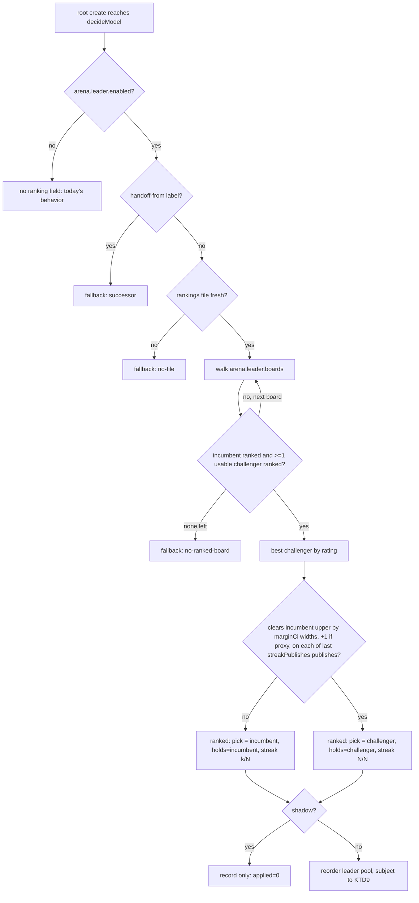

# Arena-ranked leader pick, shadow first - Plan

**Target repo:** paseo fork, branch `feat/arena-leader-pick` (off `multi-account-orchestrator` @ 08d9405a2). All paths are relative to the repo root; most live under `plugins/claude-account-pool/`.

**Evidence base:** `docs/design-notes/2026-10-20-leader-model-research.md`. Its bottom line: keep Opus 5.5; it is the only model that clears every other model's CI on the `agent` board, and no challenger is close enough that a switching rule would fire today.

**Product Contract preservation:** no prior Product Contract. The defaults below come from the leader's brief (`arena-leader-pick.md`, 2026-10-20) and are recorded as KTDs.

---

## Goal Capsule

- **Objective:** compute and record, at every leader create, which model the LMArena rankings would pick from Tyler's leader pool, without applying it, so a later flip to live is a config change backed by days of evidence.
- **Authority:** this plan, then `docs/arena-ranking.md` (worker ranking, which this extends), then `docs/coding-standards.md`. The brief's defaults win over anything this plan leaves open.
- **Stop conditions:** stop and report if wiring the leader branch would change any worker or reviewer decision, or if a leader's decided model could change after create on any path (resume, reload, failover, import).
- **Execution profile:** pure-function first. Every rule lands in a pure function (`server/arena-model-pick.ts`, or `shared/arena-leader-rule.ts` for the margin test both the pick and the alert share), tested in `server/arena-model-pick.test.ts` before `decideModel` calls it.
- **Tail:** commit on the branch; shipping, PR and merge follow the fork's normal merge gate (`docs/development.md`). Live mode is not flipped by this work.

---

## Product Contract

### Summary

Add a leader branch to the arena-ranked model pick. It ranks the leader pool on a leader board list, keeps the incumbent (the pool's first entry, Opus 5.5 today) unless a challenger clears it by a margin for several consecutive publishes, and records the result on the create's decision and `paseo.arena-pick` label. It ships off, and shadow when on. A separate pure function reports models that rank above the incumbent but sit in no pool, for the classifier dashboard.

### Problem Frame

Leaders are fixed to Opus 5.5 at xhigh because `decideArenaPick` refuses the `leader` role outright (`docs/arena-ranking.md`, "Fail-open order"). Tyler wants leaders to keep up with new models without anyone re-checking the leaderboard by hand. A leader is the most expensive and longest-lived agent in the fleet, so the bar for moving it has to be far higher than for a worker, and a wrong move has to be visible before it is live.

### Requirements

**Switching and scope**

- R1. A leader's pick is computed only when `agentModelPolicy.arena.leader.enabled` is true. Absent or false, a leader decision carries no `ranking` field, as today.
- R2. With `arena.leader.shadow` true (the default), the pick is recorded and never applied. The leader runs exactly what it runs today.
- R3. Candidates come only from the leader role's own pool (`classModels(leaderRole, taskClass)`), Codex refs excluded as today. Ranking never adds a model.
- R4. The leader's thinking level stays `policy.thinking.leader` (xhigh). Ranking never changes thinking, account routing, budget gates or failover.

**The rule**

- R5. The incumbent is the leader pool's first entry. Pool order settles every tie, so the incumbent holds unless a challenger clearly wins.
- R6. A challenger wins one publish when its CI lower bound clears the incumbent's CI upper bound by `marginCi` widths of the challenger's own CI (default 1), plus one more width when the challenger's row is an effort proxy and the incumbent's is not.
- R7. A challenger becomes the pick only after the same challenger wins `streakPublishes` (default 3) consecutive distinct publishes of the same board.
- R8. Boards are walked in `arena.leader.boards` order (default `agent/overall`, then `text_style_control/hard_prompts`). The first board that ranks the incumbent and at least one usable challenger decides. Scores are never mixed across boards.

**Decided once**

- R9. The pick happens only in the `before("agent.create")` hook. Resume, reload, account moves and import successors keep the model the agent already has.
- R10. A create carrying `handoff-from` (an import successor) is never re-picked, even if a future path runs the hook for it.

**Visibility**

- R11. Every evaluated leader decision records its outcome on `model.ranking` and the decision-log line, including fallbacks, the best challenger and its streak.
- R12. A ranked leader decision writes `paseo.arena-pick` with `role=leader`, the incumbent and the streak appended to the v1 fields.
- R13. A pure function lists models that rank above the incumbent on the first leader board, clear the R6 bar, and are in no pool. The explain RPC returns that list so the classifier dashboard can show the top one as a summary line.

### Acceptance Examples

- AE1. Policy has `arena.enabled: true` and no `arena.leader`: a root create's decision has no `ranking` (R1).
- AE2. `arena.leader: { enabled: true }`, today's file: Opus 5.5 0.2035 [0.1779, 0.2291] and Opus 5 0.0808 on `agent/overall`. Pick is the incumbent, `holds: "incumbent"`, best challenger Opus 5, streak 0/3, `applied: false` (R2, R5).
- AE3. A pool of Opus 5.5 then Sonnet 5.5, where Sonnet 5.5 clears the margin on the two most recent publishes but not the third: pick stays Opus 5.5, streak 2/3 (R7).
- AE4. Same, cleared on three consecutive publishes, `shadow: true`: the recorded pick is Sonnet 5.5 with `applied: false`, and the leader still runs Opus 5.5 (R2).
- AE5. A failover import successor create with `handoff-from` set: fallback `successor`, no reorder (R10).

### Scope Boundaries

- Flipping `arena.leader.shadow` to false. The live code path exists so the flip is config-only, but turning it on is Tyler's call after reading the shadow record.
- Codex or any non-Claude leader. Leaders stay Claude-only (`decideModel`'s `codexIneligible`); the research note prices what a Codex leader would cost.
- Fable 5.1 or any model outside the leader pool. Policy keeps Fable out; ranking never adds a model (R3).
- Changing worker or reviewer ranking (`decideArenaPick`), its boards, or `topTier`.

### Deferred to Follow-Up Work

- The dashboard UI line itself (R13's rendering) lands on or after `feat/classifier-dashboard` (plan `docs/plans/2026-10-20-001-feat-classifier-dashboard-plan.md` on that branch, not merged). This plan ships the pure function and the RPC field; U6 notes the hand-off.
- An "unpooled challenger" push notification. Tyler's notification policy keeps pushes to questions, permissions, builds, re-auth and losses.

---

## Planning Contract

### Key Technical Decisions

- **KTD1. A separate leader core, not a `leader` case inside `decideArenaPick`.** The worker core ranks by kind of work, drops top-tier refs, and lets a top-tier pick win on one publish. None of that fits a leader, and threading a leader mode through it would put the worker rules at risk. `decideLeaderPick` is a sibling export in `server/arena-model-pick.ts` that reuses `bestRowFor`, `ciOverlaps`-style helpers and `ARENA_CREDIT`.
- **KTD2. Nested `arena.leader` policy, off in code.** `ArenaPolicySchema` gains an optional `leader` object: `enabled` (false), `shadow` (true), `boards` (`["agent/overall", "text_style_control/hard_prompts"]`), `marginCi` (1), `streakPublishes` (3). Nesting keeps the worker `arena.enabled` and `arena.shadow` from ever switching leaders on, and `roles` keeps refusing `leader` as today.
- **KTD3. Incumbent is pool order, not the best-ranked candidate.** Opus 5.5 stays the default until something clearly beats it (brief). The worker rule settles CI-overlap ties by pool order too; the leader rule adds the margin and the streak on top. Today Opus 5.5 vs GPT-6 Astra on `agent/overall` clears by 0.004 against a CI width of 0.051, so even the incumbent would not clear a challenger by a full width. A one-width bar is high but reachable. In score terms it needs a lead of about half of each CI plus one more challenger width: with today's widths (about 0.05), roughly 0.10. That is a little less than Opus 5.5's own lead over Opus 5 (0.12, which clears Opus 5 by 1.6 widths), and about 25 times Opus 5.5's current lead over GPT-6 Astra.
- **KTD4. `agent/overall` first, then `text_style_control/hard_prompts`.** `agent` is the only board that measures a model orchestrating real multi-turn coding sessions with tools (Agent Arena: confirmed success, praise vs complaint, steerability, bash recovery, tool hallucination). It is also where the field separates most: Opus 5.5 clears every other model's CI there, while text boards put the top Claude models in one tie. `hard_prompts` is the fallback for a pool candidate the agent board does not rank yet. `expert` is rejected: its top dozen is one statistical tie, so it would never move the pick.
- **KTD5. Streak from per-publish history in the rankings file.** The daily job keeps, for each leader board, the matched rows of the last 10 distinct publish dates (`leaderHistory`), deduped by the rows' own `leaderboard_publish_date`. History accumulates from the daily refresh only. `agent` publishes about every 2 days, so a 3-publish streak becomes decidable within about a week, which shadow mode already tolerates. Seeding from the dataset's `full` split was rejected: it adds a second fetch path and fixture to save that week once. The classifier stays pure: history arrives as world data.
- **KTD6. Effort proxy costs one extra width.** Arena ranks Opus 5.5 only at Max on `agent` and only at High on text boards; leaders run xhigh. Both incumbent and challenger are usually proxies, so the extra width applies only when the challenger is a proxy and the incumbent is not, mirroring the worker rule's intent without penalizing a like-for-like comparison.
- **KTD7. Decided once, at create, by construction.** The pick lives in `decideModel`, which only the `before("agent.create")` hook calls. No path that carries an agent forward runs that hook (`role-router.ts`'s `applyJevLabels` doc comment states this for failover, resume and reload). R10's `handoff-from` guard is belt-and-suspenders for import. A model switch rebuilds the whole prompt cache, so a running leader must never be re-picked.
- **KTD8. One label, extended.** `paseo.arena-pick` keeps its v1 prefix and fields; a leader decision appends `role=leader;incumbent=<ref>;streak=<k>/<N>`. Worker labels are unchanged. Readers parse by key, so the dashboard's backfill parser (on `feat/classifier-dashboard`) must ignore unknown keys; U6 checks that.
- **KTD9. Live-mode explicit requests (deferred decision, default chosen).** The app sends the remembered model on a root create, so nearly every leader create carries an explicit request. In live mode, a request equal to the incumbent is treated as "the default" and follows the pick; any other explicit request is honored, as is `paseo.model-pin`. Shadow honors every request. Recorded as an open question for the flip.

### High-Level Technical Design

**Leader pick decision**

**Data flow**

| Stage       | Owner                                                                                      | Adds                                                                                   |
| ----------- | ------------------------------------------------------------------------------------------ | -------------------------------------------------------------------------------------- |
| Daily fetch | `server/arena-rankings.ts`                                                                 | `leaderHistory` per leader board; `boardTop` (top 10 rows, any model) per leader board |
| Cache       | `server/arena-ranking-cache.ts`                                                            | unchanged; staleness still collapses to `undefined`                                    |
| Pure core   | `server/arena-model-pick.ts` `decideLeaderPick`                                            | the leader decision                                                                    |
| Classifier  | `server/classifier.ts` `decideModel`                                                       | leader branch, `model.ranking`                                                         |
| Record      | `server/decision-log.ts`, `server/role-router.ts`                                          | decision line, `paseo.arena-pick`                                                      |
| Alert       | `shared/arena-unpooled.ts` (new) → explain RPC field; later `classifier-decisions.summary` | the "unpooled challenger" list and dashboard line                                      |

### Assumptions

- The leader role's pool is `["claude-opus-5-5", "claude-opus-5"]` in Tyler's config; tests use fixtures, never that file.
- `before("agent.create")` does not run for failover import successors today (stated in `role-router.ts`). R10 guards it anyway.
- Fable 5.1 stays out of every pool (MODEL POLICY). Nothing here reads or changes that.

### Open Questions

- **Deferred, decide at the flip:** KTD9's live handling of an explicit root-create model. The default above is safe for shadow; it matters only when `shadow` goes false.
- **Deferred, decide at the flip:** whether 3 publishes is enough. `agent` has published about every 2 days since late September (42 publishes since 2026-06-04), so 3 is roughly a week. Calibration from that history: Fable 5.1 led Opus 5.5 (High) for four publishes (09-27 to 10-02) without its CI ever clearing Opus 5.5's, so the rule would not have moved on it. U2's history keeps the cadence visible.

---

## Implementation Units

### U1. Leader policy schema

**Goal:** add `arena.leader` with safe defaults (R1, R2, KTD2).

**Requirements:** R1, R2, R6, R7, R8.

**Dependencies:** none.

**Files:**

- `plugins/claude-account-pool/shared/role-policy-schema.ts` (modify: `ArenaLeaderPolicySchema`, optional `leader` on `ArenaPolicySchema`)
- `plugins/claude-account-pool/shared/arena-aliases.ts` (modify: `LEADER_BOARD_IDS`, the boards that get history)
- `plugins/claude-account-pool/server/role-policy.test.ts` (modify)

**Approach:** `leader` is optional so every stored config parses unchanged. Inner defaults: `enabled: false`, `shadow: true`, `boards: ["agent/overall", "text_style_control/hard_prompts"]`, `marginCi: 1` (min 0), `streakPublishes: 3` (int, min 1, max 10 to match the history bound). `boards` is validated against `LEADER_BOARD_IDS` (`agent/overall`, `text_style_control/hard_prompts`), the only boards U2 keeps history for, so a typo or an unhistoried board fails at load instead of silently never letting a challenger win. Update the schema doc comment; `roles` still refuses `leader`.

**Patterns to follow:** `ArenaPolicySchema`'s own doc-commented defaults.

**Test scenarios:**

- A policy with `arena` and no `leader` parses to `arena.leader === undefined`.
- `arena.leader: {}` parses to the five defaults above.
- `streakPublishes: 0`, `marginCi: -1`, an unknown board id, and a real board outside `LEADER_BOARD_IDS` (e.g. `webdev/overall`) are each rejected.
- A round trip through the policy save path keeps `arena.leader` (the settings editor must not strip it).

**Verification:** the policy tests pass; an old config file loads with no `leader` key.

### U2. Rankings file: per-publish history and top rows for leader boards

**Goal:** give the pure core what the streak and the unpooled check need (R7, R13, KTD5).

**Requirements:** R7, R8, R13.

**Dependencies:** U1 (`LEADER_BOARD_IDS`).

**Files:**

- `plugins/claude-account-pool/shared/arena-aliases.ts` (modify: `ArenaRankingsFileSchema` gains optional `leaderHistory` and `boardTop`)
- `plugins/claude-account-pool/server/arena-rankings.ts` (modify)
- `plugins/claude-account-pool/server/arena-rankings.test.ts` (modify)

**Approach:** `leaderHistory: Record<boardId, Array<{ publishDate, rows: ArenaRankingRow[] }>>`, newest first, at most 10 entries per board, deduped by publish date. Each refresh carries the previous file's history forward and prepends the board's current publish when it is new. A refresh sees only the latest publish, so two publishes between refreshes leave one unrecorded; the streak counts consecutive recorded publishes and cannot see an unrecorded one. With a daily refresh and a publish about every 2 days this is rare, and shadow mode makes it visible before it matters. Model names drift between publishes ("GPT 6 Astra" vs "GPT-6 Astra"); `canonicalArenaName` already folds both. `boardTop: Record<boardId, Array<{ arenaName, ours?: string, effort?, rating, ratingLower, ratingUpper, votes }>>` holds the top 10 rows of each leader board, matched or not, so an unaliased model is visible. Dedupe keys on each board's real publish date, not on `ArenaRankingsFile.publishDate`, which `refreshArenaRankings` sets to the fetch date and so changes every run. `normalizeRow` drops `leaderboard_publish_date` today; thread it through `fetchBoardsGroupedByConfig` and `normalizeBoardRows` so each leader board carries its own publish date (boards publish on different days: `agent_bash_recovery_steps` was 10-08 while `agent` was 10-19). Both fields are optional so an old file still parses. When `retryFailedBoards` recovers a leader board, its merge prepends that board's history entry and replaces its `boardTop` from the recovered rows, so a transient 429 does not cost a challenger a publish.

**Patterns to follow:** `fetchBoardsGroupedByConfig`, `retryFailedBoards`'s merge, the existing fixture style.

**Test scenarios:**

- A refresh with a new publish date prepends one history entry; a refresh with the same date leaves history unchanged.
- History is capped at 10 per board, dropping the oldest.
- A first refresh with no prior file starts each leader board's history with one entry.
- A failed board keeps its previous history untouched (no entry is dropped or invented).
- `boardTop` keeps an unmatched row (e.g. "Gemini 4 Argon (High)") with no `ours`.
- Two refreshes on different days that see the same board publish date add one entry, not two (the fetch date is ignored).
- A leader board that failed the daily refresh and recovers on retry gets its history entry and `boardTop` from the retry merge.
- An old file without either field parses; a retry merge of a non-leader board leaves both fields untouched.

**Verification:** fixture tests pass; a file written by the new job parses under the old schema minus the new fields.

### U3. `decideLeaderPick`, the pure core

**Goal:** implement the leader rule (R3, R5–R8, R10, KTD1, KTD3, KTD6).

**Requirements:** R3, R5, R6, R7, R8, R10.

**Dependencies:** U1, U2.

**Files:**

- `plugins/claude-account-pool/shared/arena-leader-rule.ts` (new: `clearsLeaderBar`, the one R6 test both the pick and U5's alert import)
- `plugins/claude-account-pool/server/arena-model-pick.ts` (modify: export `decideLeaderPick`, `LeaderPickDecision`)
- `plugins/claude-account-pool/server/arena-model-pick.test.ts` (modify: new `describe("decideLeaderPick")`)

**Approach:** inputs are the leader pool, `isUsable`, `arena.leader`, the rankings file, the planned effort (`policy.thinking.leader`), and whether the create carries `handoff-from`. Fallbacks, in order: `disabled`, `successor`, `no-file`, `no-ranked-board`. The incumbent is `pool[0]` whatever its usability (selection already skips a capped incumbent); challengers are the other usable pool refs. Per board: rank incumbent and challengers with `bestRowFor`; skip the board unless the incumbent and at least one challenger have rows. The best challenger is the highest-rated challenger on the newest publish, and it stays fixed for the streak. Walk that board's history newest first and count consecutive entries where that same ref clears the R6 bar against that entry's incumbent row; an entry with no row for either ref, or missing history, ends the count. The ranked outcome carries `ref` (incumbent or challenger), `holds`, `incumbent` and `challenger` snapshots, `streak: { won, needed }`, `board`, `publishDate`, `credit`.

**Technical design (directional):** `clearsLeaderBar(challenger, incumbent) = challenger.lower - (marginCi + proxyExtra) * width(challenger) > incumbent.upper`, where `proxyExtra` is 1 when only the challenger is a proxy.

**Patterns to follow:** `decideArenaPick`'s fallback-first structure and `toSnapshot`.

**Test scenarios:**

- Covers AE2. Today's `agent/overall` numbers (fixture): pick Opus 5.5, `holds: "incumbent"`, challenger Opus 5, streak 0/3.
- Covers AE3. Challenger clears on 2 newest of 3 publishes: incumbent holds, streak 2/3.
- Covers AE4. Clears on 3 consecutive: pick is the challenger, streak 3/3.
- A break in the middle (clear, miss, clear) gives streak 1, not 2.
- A different challenger tops each of the three publishes, each clearing the bar: streak 1, incumbent holds.
- Calibration fixture from the real history (Fable 5.1 leading Opus 5.5 (High) 09-27 to 10-02 with overlapping CIs): incumbent holds on every publish.
- Non-overlapping CIs but under one extra width: incumbent holds.
- Challenger is a proxy and the incumbent is not: needs one more width; both proxies: no extra width.
- Incumbent unranked on `agent/overall` but ranked on `hard_prompts` with a challenger: decides on `hard_prompts`.
- Only the incumbent ranked anywhere: `no-ranked-board`.
- Challenger unusable (capped): excluded; if no other challenger, `no-ranked-board`.
- `handoff-from` present: `successor`, even with a winning challenger.
- `enabled: false` or no `leader` key: `disabled`.
- An unknown effort id on `policy.thinking.leader`: proxies refused (existing `bestRowFor` rule), so the board is skipped.
- Fewer history entries than `streakPublishes`: streak counts what exists and the challenger cannot win.

**Verification:** all scenarios pass; `decideArenaPick`'s existing tests are untouched and pass.

### U4. Wire the leader branch into `decideModel`, the record, and the label

**Goal:** leader creates carry the decision (R1, R2, R4, R9, R11, R12, KTD7, KTD8, KTD9).

**Requirements:** R1, R2, R4, R9, R11, R12.

**Dependencies:** U3.

**Files:**

- `plugins/claude-account-pool/server/classifier.ts` (modify: leader branch in `decideModel`; `ModelDecision.ranking` widened to a leader variant)
- `plugins/claude-account-pool/server/decision-log.ts` (modify: `describeRanking` for the leader variant)
- `plugins/claude-account-pool/server/role-router.ts` (modify: `formatArenaPickLabel` appends the leader fields; fix the "a leader never reaches this" comment)
- `plugins/claude-account-pool/server/classifier.test.ts`, `server/decision-log.test.ts`, `server/role-router.test.ts` (modify)
- `plugins/claude-account-pool/client/settings/explain-summary.ts` and its test (modify: describe a leader pick in the settings preview)

**Approach:** in `decideModel`, when `role.id === LEADER_ROLE_ID` and `world.policy.arena?.leader?.enabled`, call `decideLeaderPick` and attach `ranking` with `applied = ranked && !leader.shadow && holds === "challenger"`. When applied, reorder with `moveRefToFront` as the worker path does. An explicit request follows KTD9: honored in shadow; in live, overridden only when it equals the incumbent and `paseo.model-pin` is absent. The worker branch condition stays `role.id !== LEADER_ROLE_ID`, so worker behavior cannot change. The label's `applied` always equals `ranking.applied`: 1 only when the challenger ran. If the incumbent is unusable at create (capped), the record still says the incumbent holds, and the decision's `model` shows what actually ran.

**Patterns to follow:** the worker branch's shadow/live and honored-request handling; `rankingMatchesRequestedModel`.

**Test scenarios:**

- Covers AE1. `arena.enabled: true`, no `leader`: no `ranking` on a root create (the existing "no leader decision carries a ranking" test keeps passing).
- `leader.enabled: true`, shadow, challenger winning: the leader runs the incumbent, `ranking.applied` false, label `applied=0;role=leader;incumbent=claude-opus-5-5;streak=3/3`.
- Shadow with an explicit Opus 5.5 request: `honored-request`, ranking recorded at `applied: false`.
- Live, challenger winning, no request: pool reordered, challenger runs, `applied: true`.
- Live, request equals the incumbent: challenger runs, `override.reason: "arena-ranked"`.
- Live, request is Opus 5 (not the incumbent): honored, ranking `applied: false`.
- Live with `paseo.model-pin`: honored.
- Thinking stays the leader rule's xhigh in every case above (R4).
- A worker create with `arena.leader.enabled` true and identical rankings gets the same decision as with `leader` absent.
- Decision-log line carries `holds`, `streak`, `incumbent`, `challenger` for a leader; a leader fallback carries its reason.
- Covers AE5. A root create with `handoff-from`: ranking fallback `successor`, model as requested.

**Verification:** the files in Verification Contract pass; a worker-only diff of decisions on the existing fixtures is empty.

### U5. Unpooled-challenger finder

**Goal:** name models that would beat the incumbent but are in no pool (R13).

**Requirements:** R13.

**Dependencies:** U1, U2, U3 (`clearsLeaderBar`).

**Files:**

- `plugins/claude-account-pool/shared/arena-unpooled.ts` (new: `findUnpooledLeaderChallengers`)
- `plugins/claude-account-pool/shared/arena-unpooled.test.ts` (new)
- `plugins/claude-account-pool/server/role-policy-rpc-handlers.ts` (modify: the explain response gains an optional `unpooledLeaderChallengers` field)
- `plugins/claude-account-pool/shared/role-policy-rpc.ts` (modify: optional output field)
- `plugins/claude-account-pool/server/role-policy-rpc-handlers.test.ts` (modify)

**Approach:** read `boardTop` for `arena.leader.boards[0]` (default `agent/overall`) and test with `clearsLeaderBar`, without the proxy extra width (an unaliased row has no known effort; this is an alert, not a pick). Find the incumbent's row; return every row above it that clears the bar (no streak) and whose `ours` is absent or in no role's pool. Each result carries the arena name, rating and CI, the margin in CI widths, the board and publish date. Runs whether or not `leader.enabled` is on, since its job is to prompt Tyler to add a model.

**Test scenarios:**

- Today's fixture: empty (nothing clears Opus 5.5 by a width).
- A fixture where an unaliased row clears the bar: one result, `ours` absent.
- A row that clears the bar but maps to a pooled ref (worker pool): excluded.
- A row that maps to a ref in no pool (e.g. a Codex ref absent from every role): included.
- Incumbent missing from `boardTop`: empty, no throw.
- No `boardTop` in the file: empty.

**Verification:** tests pass; the explain RPC returns the field.

### U6. Docs and the dashboard hand-off

**Goal:** one doc owns the leader rule; the dashboard branch knows what to render (R13, KTD8).

**Requirements:** R11, R12, R13.

**Dependencies:** U4, U5.

**Files:**

- `docs/arena-ranking.md` (modify: a "Leaders" section; policy table row for `leader`; leader fallback reasons; labels; tests list)

**Approach:** rewrite the lines that say ranking never runs for a leader instead of appending a caveat. Name the dependency: the dashboard plan's `classifier-decisions.summary` gains one line, "Unpooled model ahead of the leader: <name>, +<k> CI widths on <board> (<date>)", fed by U5, and its `paseo.arena-pick` backfill parser must ignore unknown keys (KTD8). If `feat/classifier-dashboard` has merged into `multi-account-orchestrator` before this branch ships, rebase and make `classifier-decisions.summary` call `findUnpooledLeaderChallengers` in this branch. Otherwise the dashboard branch adds that call, and this branch leaves the note in `docs/arena-ranking.md`.

**Test expectation:** none -- documentation only.

**Verification:** `docs/arena-ranking.md` describes the leader rule with no remaining "never for a leader" claim; the dashboard dependency is written down.

---

## System-Wide Impact

- **Prompt cache:** no running agent's model changes (R9). Only new leaders could get a different model, and only in live mode.
- **Workers and reviewers:** untouched by construction (KTD1, U4's worker regression test).
- **Account routing and budget:** unchanged. A live challenger that is a different Claude model still routes through `decideRootAccount` and the usability gate.
- **Rankings file:** grows by at most 10 publishes × 2 boards of matched rows plus 20 top rows; tens of KB.

## Risks & Dependencies

| Risk                                                               | Mitigation                                                                                     |
| ------------------------------------------------------------------ | ---------------------------------------------------------------------------------------------- |
| A noisy publish flips the fleet's leader                           | margin + streak (R6, R7); shadow default; pool order ties                                      |
| Agent Arena methodology changes mid-streak (it changed 2026-10-01) | streak resets naturally when the challenger stops clearing; history shows the jump             |
| Arena ranks Max/High, leaders run xhigh                            | proxy extra width (KTD6); all candidates are proxies today, so the comparison is like for like |
| Dashboard parser chokes on the extended label                      | KTD8; U6 checks the parser                                                                     |

Dependency: the dashboard line (R13 rendering) needs `feat/classifier-dashboard`.

---

## Verification Contract

- Targeted tests only (never the full suite): `cd plugins/claude-account-pool && npx vitest run server/arena-model-pick.test.ts server/arena-rankings.test.ts server/classifier.test.ts server/decision-log.test.ts server/role-router.test.ts server/role-policy.test.ts server/role-policy-rpc-handlers.test.ts shared/arena-unpooled.test.ts client/settings/explain-summary.test.ts`. Gate the merge on this whole set in one run without `--bail` (merge-gate practice).
- `npm run typecheck` and `npm run lint` after every unit; `npm run format` before committing.
- Smoke: with a scratch `PASEO_HOME` (`docs/ad-hoc-daemon-testing.md`), set `arena.leader.enabled: true`, create one root agent, and read its `classifier-decision` line and `paseo.arena-pick` label. Never restart the 6767 daemon.

## Definition of Done

- All units' test scenarios pass in the targeted run; typecheck and lint are clean.
- A config without `arena.leader` produces byte-identical decisions for every role.
- With `arena.leader.enabled: true` and default shadow, a root create records the leader pick and runs the same model it ran before.
- `docs/arena-ranking.md` owns the leader rule; the dashboard dependency is written down.
- No dead or experimental code from abandoned approaches is left in the diff.
