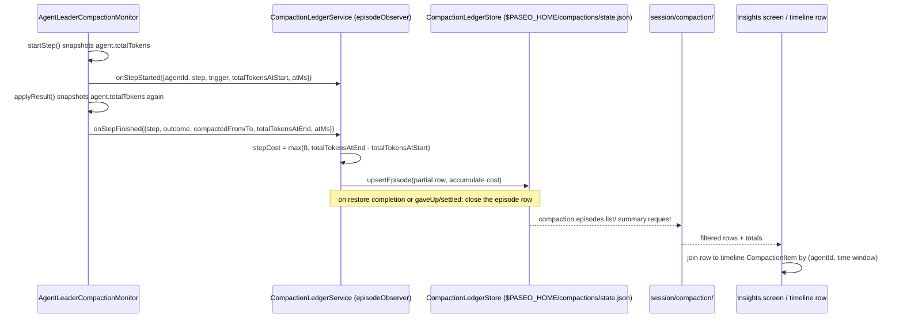
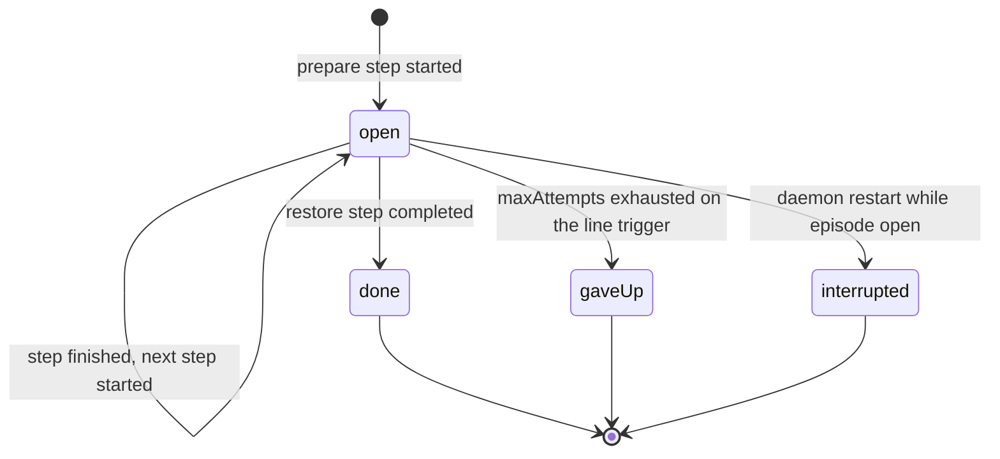

# feat: Insights screen and compaction episode ledger

## Summary

Tyler wants to know what a compaction costs. Today `AgentLeaderCompactionMonitor` runs its
three-step prepare → `/compact` → restore cycle and logs each step, but nothing durable records
what any one episode cost or saved, and the timeline's "Compaction" row is a static divider with
no numbers on it. This plan adds a bounded, durable compaction-episode ledger in the daemon, a
dotted-namespace RPC to read it, a new **Insights** sidebar entry with a Compactions section, and
an upgraded timeline Compaction row with a JEV-marker-style popover — all built on patterns already
in the repo (`docs/token-usage.md`'s store/scanner shape for the ledger, `jev.savings.events` for
the RPC, the JEV dashboard and marker chip for the two UI surfaces).

## Problem Frame

- `docs/leader-compaction.md` documents the monitor's own three-step sequence and its logging, but
  the monitor keeps state in memory only (`agent-leader-compaction-monitor.ts:215`) — nothing
  survives a restart or feeds a UI.
- `docs/token-burn.md` defines the weighted-token unit (`weighTokenUsage`,
  `packages/server/src/server/agent/token-rate-tracker.ts:39`) that every cost figure in this plan
  must use, and documents `ActiveManagedAgent.totalTokens` as a running lifetime counter already
  updated on every request (`agent-manager.ts:6715-6720`).
  — this plan's primary cost signal is a snapshot-diff of that counter, not a new accounting path.
- The timeline's `CompactionItem` (`packages/app/src/types/stream.ts:793-802`) already carries
  `trigger` and `preTokens` for Claude's native auto/manual compactions
  (`packages/server/src/server/agent/providers/claude/agent.ts` around lines 4666-4698 and
  6712-6727), but nothing adds `postTokens` to the item, nothing is interactive, and nothing joins
  it to the richer per-step record this plan adds for monitor-driven episodes.
- `fix/compaction-quiet-moment` (worktree `/Users/tylerthackray/.paseo/worktrees/3jvw4yw6/compaction-quiet-moment`)
  is adding a quiet-gate deferral (`quietMinutes`, `ceilingTokens`) and carried human prompts to the
  same monitor file. At plan time that branch has made **no commits yet** —
  `git log fix/compaction-quiet-moment --not origin/multi-account-orchestrator` is empty, and the
  branch ref equals `origin/multi-account-orchestrator`'s tip (`9de4e59ef`). This plan does not wait
  on it: the ledger's ingest surface for those fields stays optional and unwired, per U1.

## Requirements

- **R1.** A durable, bounded per-episode ledger under `$PASEO_HOME` recording: agent id/title,
  trigger (`line`/`early`, with the early reason), per-step timestamps (prepare, compact, restore),
  context before/after (`usedTokens`, `compactedFromTokens`, `compactedToTokens`), outcome (done,
  gave up, cancelled/interrupted-by-restart), note length, and prompts-carried count when known.
- **R2.** A measured cost per episode in weighted tokens (`docs/token-burn.md`'s unit): the sum of
  the prepare, compact, and restore turns' own token spend. An estimated payback: tokens dropped ×
  requests made since, at the cache-read weight (0.1). The UI and docs must say plainly which figure
  is measured and which is estimated.
- **R3.** Episodes the daemon can see but that did not come from this monitor — Claude Code's own
  auto-compact, or a user's manual `/compact` — are recorded too, with whatever fields are known
  (trigger, preTokens, postTokens) and cost explicitly marked unmeasured (no step boundaries exist
  to attribute spend to).
- **R4.** A one-time backfill from `$PASEO_HOME/*daemon.log`, guarded by a completion marker so it
  never reruns, populating the screen on day one with monitor-driven episodes. Backfilled rows have
  no cost figure (the per-step `totalTokens` snapshots this plan's live cost measurement depends on
  were never taken for history) — marked unmeasured, same as R3's native rows.
- **R5.** A new dotted-namespace RPC pair, filterable by agent id and by range (`today`/`7d`/`all`),
  gated on a new `server_info.features.compactionLedger` flag per `docs/protocol-compatibility.md`.
- **R6.** A new **Insights** sidebar entry (beside JEV) opening a screen with a Compactions section:
  totals (count, total cost, average cost, estimated saved), a newest-first list with agent, time,
  trigger, before → after, cost, payback, quiet-gate wait and carried prompts when present, and
  links to the JEV dashboard, the classifier Decisions dashboard, and Token usage. Works on
  compact/phone and wide layouts.
- **R7.** The timeline's Compaction row shows before → after, cost, and trigger in one line, with a
  tap/hover popover (JEV-marker pattern) holding per-step times/cost, carried prompts, and payback.
  Joined to its ledger episode by agent + time. A compaction with no ledger row still renders as
  today (R3/R4 coverage closes most of this gap, but the row must degrade gracefully regardless).

## Key Technical Decisions

**KTD1 — Cost is a `totalTokens` snapshot diff, not a new accounting path.** `ActiveManagedAgent`
already maintains a lifetime weighted-token counter (`agent.totalTokens`,
`agent-manager.ts:6715-6720`) incremented on every `token_burn_delta`/`turnTokenDelta`. The monitor
already knows exactly when each step's turn starts and ends. Recording `totalTokens` at both
moments and diffing gives the step's own cost with zero new event plumbing and no risk of double
counting. The alternative — subscribing to live `token_burn_delta` events and summing them inside a
time window — needs a new generic AgentManager subscription and a window-matching race between the
subscription and the turn; the snapshot diff needs neither.

**KTD2 — The monitor gets an additive `episodeObserver` option; no planner types change.**
`leader-compaction-planner.ts` is pure and under active edit on `fix/compaction-quiet-moment`. This
plan touches only `agent-leader-compaction-monitor.ts` (adding an optional
`episodeObserver` field to `AgentLeaderCompactionMonitorOptions` and two call sites) and
`agent-manager.ts` (adding `totalTokens` to `LeaderCompactionAgentSummary` and a small
`subscribeTokenBurn` hook for the payback counter, both pure additions next to existing fields/hooks
of the same shape). Nothing in the planner's discriminated unions changes, so the two branches
cannot conflict on the same lines.

**KTD3 — Payback counts requests via the existing token-burn signal, not a new turn counter.**
`docs/token-burn.md` establishes that each Claude `token_burn_delta` corresponds to one API
request. `AgentManager.recordTokenBurn` (`agent-manager.ts:6715`) already fires once per such
event. Adding a small `subscribeTokenBurn(listener)` next to the existing `subscribeOperatorSignals`
(`agent-manager.ts:2211-2217`, same `Set<listener>` shape) lets the ledger service count requests
per agent since its last-closed episode without inventing a second definition of "a request."

**KTD4 — The ledger is modeled on `TokenUsageStore`, not `JevLedger`.** `JevLedger`
(`packages/server/src/server/jev/ledger.ts`) persists only daily totals; the Insights list needs
individual episode rows. `TokenUsageStore`
(`packages/server/src/server/token-usage/token-usage-store.ts`) already has the exact shape this
plan needs: one state file, Zod-versioned, atomic debounced writes, a `backfillDoneAtMs` marker
distinct from a `recordingSinceMs` marker, and bounded storage on every axis. This plan copies that
shape rather than inventing a new one.

**KTD5 — Backfill and native-compaction coverage are cost-blind by design, and the UI says so.**
Reconstructing per-step cost for history (R4) or for Claude's own auto-compact (R3) would mean
re-deriving `totalTokens`-equivalent figures from raw transcripts for arbitrary past windows —
effectively rebuilding `TokenUsageService`'s scanner (`docs/token-usage.md`) scoped to compaction
windows. That is out of scope for this plan (see Deferred to Follow-Up Work). Recording these rows
with `cost: null` and a `costBasis: "unmeasured"` field, surfaced plainly in the UI copy, is more
honest than a fabricated estimate and lets R1/R6/R7 ship without it.

## High-Level Technical Design





## Output Structure

```
packages/server/src/server/compaction-ledger/
  compaction-ledger-store.ts        (U2)
  compaction-ledger-store.test.ts   (U2)
  compaction-ledger-service.ts      (U3)
  compaction-ledger-service.test.ts (U3)
  compaction-ledger-backfill.ts     (U4)
  compaction-ledger-backfill.test.ts(U4)
  compaction-ledger-cost.ts         (U3 — pure cost/payback math)
  compaction-ledger-cost.test.ts    (U3)

packages/app/src/insights/
  use-compaction-episodes.ts        (U6)
  use-compaction-episodes.test.ts   (U6)
  compaction-episode-row.tsx        (U6/U7 shared row renderer)

packages/app/src/screens/
  insights-screen.tsx                (U6)
  insights-view.tsx                  (U6)
  insights-view.browser.test.tsx     (U6)
```

## Implementation Units

### U1. Episode observer hook on the monitor; `totalTokens` and token-burn subscription on AgentManager

**Goal:** Give the ledger service a way to see every step start/finish and every token-burn event,
without restructuring `agent-leader-compaction-monitor.ts` or touching `leader-compaction-planner.ts`.

**Requirements:** R1, R2 (cost inputs), KTD1, KTD2, KTD3

**Dependencies:** none

**Files:**

- `packages/server/src/server/agent-leader-compaction-monitor.ts` (modify)
- `packages/server/src/server/agent/agent-manager.ts` (modify)
- `packages/server/src/server/agent-leader-compaction-monitor.test.ts` (modify — exercise the new
  observer calls; this file already exists for the monitor's own tests)

**Approach:**

- In `agent-manager.ts`, add `totalTokens: agent.totalTokens` to the object `listAgentsForLeaderCompaction()`
  returns (line ~2187-2199) and the matching optional field on `LeaderCompactionAgentSummary`
  (line ~571). Add `subscribeTokenBurn(listener: (agentId: string, tokens: number) => void): () => void`
  next to `subscribeOperatorSignals` (line ~2211), backed by its own `Set`, invoked from
  `recordTokenBurn` (line ~6715) after it updates `agent.totalTokens`.
- In `agent-leader-compaction-monitor.ts`, add an optional `episodeObserver` field to
  `AgentLeaderCompactionMonitorOptions` (around line 40-53) of a new interface
  `LeaderCompactionEpisodeObserver` (define it in this file; it is monitor-local, not a planner
  type):
  ```ts
  interface LeaderCompactionEpisodeObserver {
    onStepStarted(input: {
      agentId: string;
      agentTitle: string | null;
      step: LeaderCompactionStep;
      attempt: number;
      trigger: LeaderCompactionTrigger;
      usedTokens: number | undefined;
      totalTokensAtStart: number | undefined;
      atMs: number;
    }): void;
    onStepFinished(input: {
      agentId: string;
      step: LeaderCompactionStep;
      outcome: "completed" | "canceled" | "failed" | "busy" | "notCompacted";
      gaveUp: boolean;
      episodeEnded: "done" | "gaveUp" | null;
      compactedFromTokens: number | null;
      compactedToTokens: number | null;
      noteLength: number | null;
      totalTokensAtStart: number | undefined;
      totalTokensAtEnd: number | undefined;
      atMs: number;
    }): void;
  }
  ```
  Directional only — field names may tighten during implementation as long as both callbacks carry
  everything listed.
- Add a private `stepStartTotals = new Map<string, number | undefined>()` keyed by agent id. Set it
  in `startStep()` right after the existing `"Leader compaction started a step"` log (line ~459),
  then call `this.options.episodeObserver?.onStepStarted(...)`.
- In `finishStep()` (line ~467), after computing `result` via `toTurnResult`, also look up the
  agent's current `totalTokens` via one more `listAgentsForLeaderCompaction().find(...)` call (same
  pattern `toTurnResult` already uses for `usedTokensAfter`) and pass it into `applyResult` as a new
  parameter.
- In `applyResult()` (line ~494), after the existing success/failure log branches, call
  `this.options.episodeObserver?.onStepFinished(...)` with the values collected above, reading
  `stepStartTotals.get(agent.id)` and then deleting that entry. Determine `episodeEnded` from
  `applied.state.phase` (`"settled"` with `reason: "done"` or `"gaveUp"`) and `outcome` from
  `applied.failure?.kind ?? "completed"`.
- Leave `quietMinutes`/`ceilingTokens`/carried-prompt fields out of this observer entirely for now
  — `LeaderCompactionEpisode` does not carry them yet (see Problem Frame). U3 defines them as
  optional ledger-row fields so a future rebase can wire them without a ledger schema change.

**Patterns to follow:** `agent-manager.ts:2211-2217` (`subscribeOperatorSignals`) for the new
`subscribeTokenBurn`; the existing `toTurnResult` lookup (`agent-leader-compaction-monitor.ts:484-492`)
for the extra `totalTokens` read.

**Test scenarios:**

- `onStepStarted` fires with the right `step`, `trigger.kind`, and `totalTokensAtStart` when a
  `prepare` step starts on an armed agent crossing the line.
- `onStepFinished` fires with `outcome: "completed"`, `episodeEnded: null` after `prepare` succeeds
  (episode continues to `compact`).
- `onStepFinished` fires with `episodeEnded: "done"` and both `compactedFromTokens`/`compactedToTokens`
  populated after `restore` completes.
- `onStepFinished` fires with `outcome: "notCompacted"`, `gaveUp: true`, `episodeEnded: "gaveUp"`
  after `maxAttempts` failed `compact` tries.
- `onStepFinished`'s `totalTokensAtEnd` reflects a `totalTokens` value that advanced during the
  turn (simulate the agent summary's `totalTokens` increasing between `startStep` and the turn's
  resolution).
- No observer configured: the monitor behaves exactly as before (regression — reuses existing test
  fixtures without an observer).
- `subscribeTokenBurn` listener receives `(agentId, tokens)` on `recordTokenBurn`, and unsubscribing
  stops delivery.

**Verification:** Existing `agent-leader-compaction-monitor.test.ts` assertions still pass unmodified
(additive change); new assertions cover every `onStepStarted`/`onStepFinished` call shape above.

---

### U2. Compaction ledger store — bounded, durable, backfill marker

**Goal:** The persistence layer: one JSON state file under `$PASEO_HOME/compactions/`, Zod-versioned,
atomic debounced writes, bounded on every axis, with a `backfillDoneAtMs` marker.

**Requirements:** R1, R3, R4, KTD4, KTD5

**Dependencies:** none (independent of U1; can be built/tested in parallel)

**Files:**

- `packages/server/src/server/compaction-ledger/compaction-ledger-store.ts` (new)
- `packages/server/src/server/compaction-ledger/compaction-ledger-store.test.ts` (new)

**Approach:**

- Mirror `token-usage-store.ts`'s shape: a Zod schema (`v: 1`), `writeFileAtomic(..., {mode: 0o600})`,
  a debounced flush, a write chain to serialize concurrent writes.
- One row per episode:
  ```ts
  interface CompactionEpisodeRow {
    id: string; // `${agentId}:${startedAtMs}`
    agentId: string;
    agentTitle: string | null;
    source: "monitor" | "native" | "manual" | "backfill";
    trigger: "line" | "early" | "auto" | "manual" | "unknown";
    triggerReason: string | null; // the "early" reason, when present
    startedAtMs: number;
    endedAtMs: number | null;
    steps: Array<{
      step: "prepare" | "compact" | "restore";
      startedAtMs: number;
      endedAtMs: number | null;
      outcome: string;
      costWeightedTokens: number | null;
    }>;
    contextBeforeTokens: number | null;
    contextAfterTokens: number | null;
    outcome: "done" | "gaveUp" | "cancelled" | "interrupted" | "unknown";
    noteLength: number | null;
    promptsCarried: number | null; // optional; filled once the quiet-gate branch lands
    quietGate: { quietMinutes: number; ceilingTokens: number } | null; // optional, same reason
    costWeightedTokens: number | null; // sum of steps' costs; null when costBasis is "unmeasured"
    costBasis: "measured" | "unmeasured";
    estimatedSavedWeightedTokens: number | null; // payback estimate, see U3
    requestsSincePaybackCountedThrough: number | null; // open window bookkeeping for payback
  }
  ```
- Bounds mirroring `DEFAULT_TOKEN_USAGE_LIMITS`: a max row count (ring, oldest dropped first) and a
  retention-days cutoff, whichever is tighter. Pick defaults consistent with the token-usage store's
  scale (e.g. a few thousand rows / 90 days) — exact numbers are an implementation-time call, not a
  product decision.
- `getBackfillDoneAtMs()` / `markBackfillDone(nowMs)`, same shape as `token-usage-store.ts:195-203`.
- A file that fails to parse is replaced and starts empty, exactly as `token-usage-store.ts` does —
  never thrown.

**Patterns to follow:** `packages/server/src/server/token-usage/token-usage-store.ts` end to end —
schema versioning, atomic writes, the backfill marker, bounded-axis eviction.

**Test scenarios:**

- Writing then reloading from a fresh `PASEO_HOME` round-trips every field of a row.
- A corrupt state file is replaced rather than thrown on load, and the store starts empty.
- Row count exceeding the bound evicts the oldest row, not an arbitrary one.
- A row older than the retention cutoff is pruned on the next write.
- `markBackfillDone` is idempotent: calling it twice does not change `getBackfillDoneAtMs()`'s
  second value.
- Concurrent `upsertEpisode` calls (two in-flight writes) do not interleave into a corrupt file —
  the write chain serializes them.

**Verification:** `npx vitest run compaction-ledger-store.test.ts` green; a manual round-trip of 10
synthetic rows survives a process restart (new store instance reading the same `PASEO_HOME`).

---

### U3. Compaction ledger service — wiring, cost math, payback estimate

**Goal:** The service that implements `LeaderCompactionEpisodeObserver`, turns step events into
store writes, computes cost, and maintains the live payback estimate via the token-burn subscription.

**Requirements:** R1, R2, KTD1, KTD3, KTD5

**Dependencies:** U1, U2

**Files:**

- `packages/server/src/server/compaction-ledger/compaction-ledger-cost.ts` (new — pure functions)
- `packages/server/src/server/compaction-ledger/compaction-ledger-cost.test.ts` (new)
- `packages/server/src/server/compaction-ledger/compaction-ledger-service.ts` (new)
- `packages/server/src/server/compaction-ledger/compaction-ledger-service.test.ts` (new)

**Approach:**

- `compaction-ledger-cost.ts` — pure, no I/O:
  - `stepCost(totalTokensAtStart: number | undefined, totalTokensAtEnd: number | undefined): number | null`
    → `Math.max(0, end - start)` when both are numbers, else `null` (unmeasured — one or both
    snapshots missing, e.g. a step that failed before `startStep` could record one).
  - `estimatedSavedWeightedTokens(contextBefore: number | null, contextAfter: number | null, requestsSince: number): number | null`
    → `(contextBefore - contextAfter) * requestsSince * 0.1` (the cache-read weight from
    `token-rate-tracker.ts`'s `TOKEN_BURN_WEIGHTS.cacheRead`), `null` when either context figure is
    missing.
- `compaction-ledger-service.ts` implements `LeaderCompactionEpisodeObserver`:
  - `onStepStarted`: opens or continues a `CompactionEpisodeRow` in the store (upsert keyed by
    `agentId` + the episode's own `startedAtMs`, carried across steps in an in-memory map alongside
    the store, the same way the monitor itself carries `LeaderCompactionState` in memory).
  - `onStepFinished`: computes `stepCost` via the pure function above, appends the step, and on
    `episodeEnded !== null` closes the row (`endedAtMs`, final `outcome`, `costBasis: "measured"`
    when every step's cost was non-null, else `"unmeasured"`).
  - Subscribes to `subscribeTokenBurn` (U1) to increment each closed episode's
    `requestsSincePaybackCountedThrough` until that agent's _next_ episode opens (per
    `docs/token-burn.md`'s per-request signal), recomputing `estimatedSavedWeightedTokens` on each
    increment (debounced to the store's existing flush cadence — no new I/O cadence).
  - Exposes `recordNativeCompaction(input: {agentId, agentTitle, trigger: "auto" | "manual",
preTokens: number | null, postTokens: number | null, atMs: number})` for R3 — a thin wrapper
    that writes a single-step, already-closed row with `source: "native" | "manual"`,
    `costBasis: "unmeasured"`. Called from the Claude provider's compaction-detection sites
    (U3 only adds the method; wiring the call site is explicitly deferred — see Scope Boundaries).
  - Exposes `list(filter)` / `summary(filter)` reading the store for U5's RPC handlers.

**Patterns to follow:** `agent-token-burn-monitor.ts`'s use of `recordTokenDelta`/`weighTokenUsage`
for the weighting convention; `jev-session.ts:591-609`'s `handleSavingsEvents` for how a filtered
read eventually becomes an RPC response (consumed by U5, not written here).

**Test scenarios:**

- `stepCost(100_000, 100_450)` → `450`; `stepCost(undefined, 100_450)` → `null`.
- `estimatedSavedWeightedTokens(400_000, 20_000, 10)` → `380_000`; either context arg `null` →
  `null`.
- A full prepare→compact→restore cycle through the service produces one closed row with
  `costBasis: "measured"` and `costWeightedTokens` equal to the sum of the three steps' costs.
- A cycle where `prepare`'s `totalTokensAtStart` was never recorded (edge case: daemon restarted
  mid-step) produces `costBasis: "unmeasured"`.
- A `gaveUp` episode closes with `outcome: "gaveUp"` and whatever step costs were measured before
  the give-up.
- `requestsSincePaybackCountedThrough` stops incrementing once that agent's next episode opens (the
  window belongs to the closed episode it followed, not to the one after).
- `recordNativeCompaction` writes a row with `costBasis: "unmeasured"` and `source: "native"`.
- `list({agentId})` and `list({range: "today"})` each return only matching rows; `summary(filter)`
  totals match a manual sum over the same filtered rows.

**Verification:** `npx vitest run compaction-ledger-cost.test.ts compaction-ledger-service.test.ts`
green; wiring the service's observer methods into a real `AgentLeaderCompactionMonitor` instance in
one integration test produces a closed row after a scripted prepare/compact/restore turn sequence.

---

### U4. Backfill from daemon logs

**Goal:** Populate the ledger from existing `$PASEO_HOME/*daemon.log` history once, guarded by the
U2 marker, so the Insights screen is not empty on day one.

**Requirements:** R4, KTD5

**Dependencies:** U2

**Files:**

- `packages/server/src/server/compaction-ledger/compaction-ledger-backfill.ts` (new)
- `packages/server/src/server/compaction-ledger/compaction-ledger-backfill.test.ts` (new)

**Approach:**

- Parse `"Leader compaction started a step"` and `"Leader compaction finished a step"` lines
  (`agent-leader-compaction-monitor.ts:459`, `:531`) from the daemon's structured log output —
  these are the exact field sets logged today: `agentId, step, usedTokens, attempt, trigger,
cutPoint?` on start; `agentId, step, next, compactedFromTokens?, compactedToTokens?` on finish.
  Join start/finish pairs by `(agentId, step)` in file order to reconstruct each step's timestamps;
  join steps into an episode by `(agentId)` with no intervening unrelated episode.
- Also parse `"Leader compaction gave up"` for the `gaveUp` outcome.
- Run once, gated by `getBackfillDoneAtMs()`; call `markBackfillDone(nowMs)` when finished, even if
  zero matching lines were found (an empty backfill is still a completed backfill).
- Every backfilled row gets `source: "backfill"`, `costBasis: "unmeasured"` (per KTD5), and
  `promptsCarried: null`.
- Scope the scan to daemon log files the way other daemon log readers in this repo already do
  (reuse whatever rotation/glob convention is already in use — check an existing daemon-log reader
  for the exact glob and line-parsing utility rather than inventing a new one).

**Patterns to follow:** `token-usage-store.ts`'s backfill-marker pattern (`backfillDoneAtMs`,
idempotent, set-once) for the guard; whatever existing daemon-log-tailing/parsing utility the repo
already has for structured JSON log lines (locate it during implementation — do not hand-roll a
second log parser if one exists).

**Test scenarios:**

- A fixture log with one full prepare/compact/restore sequence (using fake agent ids, no personal
  data) produces one closed, `"done"`-outcome row.
- A fixture log with a `gaveUp` sequence produces one `"gaveUp"`-outcome row.
- A fixture log with an interleaved `started`/`finished` pair for two different agents produces two
  separate episodes, not one merged row.
- Running the backfill twice (marker already set) performs no second write.
- A log line missing an expected field (defensive: malformed/truncated line) is skipped without
  throwing, and the rest of the file still backfills.
- An empty log file still calls `markBackfillDone`.

**Verification:** `npx vitest run compaction-ledger-backfill.test.ts` green; the output of the
fixture-file tests matches hand-computed expected rows exactly.

---

### U5. Protocol and RPC — `compaction.episodes.list` / `.summary`

**Goal:** Wire the ledger service to the client over two new dotted-namespace RPC pairs, gated on a
new feature flag.

**Requirements:** R5, `docs/rpc-namespacing.md`, `docs/protocol-compatibility.md`

**Dependencies:** U3

**Files:**

- `packages/protocol/src/messages.ts` (modify — `server_info.features.compactionLedger`)
- `packages/protocol/src/compaction/rpc-schemas.ts` (new — mirrors `packages/protocol/src/jev/rpc-schemas.ts`)
- `packages/server/src/server/session.ts` (modify — dispatch, mirrors the `dispatchJevMessage` cases)
- `packages/server/src/server/session/compaction/compaction-session.ts` (new — mirrors `jev-session.ts`'s `handleSavingsEvents`)
- `packages/server/src/server/websocket-server.ts` (modify — set `compactionLedger: true` in `server_info`)
- `packages/server/src/server/authorization/operation-permissions.ts` (modify — map both RPC names to `"workspace.read"`, mirroring the `jev.savings.events` entries)
- `packages/app/src/compactions/use-compaction-episodes.ts` (new client hook; also listed under U6)

**Approach:**

- `compaction.episodes.list.request` / `.response`: `{agentId?: string, range: "today" | "7d" | "all", cursor?: string, limit?: number}`
  → `{episodes: CompactionEpisodeRow[], nextCursor: string | null}`, following
  `JevSavingsEventsRequestSchema`/`...ResponseSchema` (`packages/protocol/src/jev/rpc-schemas.ts:438-458`)
  field-for-field in shape.
- `compaction.episodes.summary.request` / `.response`: same filter shape minus pagination →
  `{count, totalCostWeightedTokens, averageCostWeightedTokens, totalEstimatedSavedWeightedTokens,
measuredCount, unmeasuredCount}`.
- Every new wire field is `.optional()`; the `CompactionEpisodeRow`-shaped payload schema stays a
  pure structural declaration (no `.transform()`/`.catch()`/`.preprocess()`) per
  `docs/protocol-compatibility.md`.
- Add the `// COMPAT(compactionLedger): added in v<next>, remove gate after <date>.` comment beside
  the new feature flag, matching the `jevSavings` example already in `messages.ts`.
- Permission: `"workspace.read"`, same tier as `jev.savings.events` (read-only, no write surface).

**Patterns to follow:** The full `jev.savings.events` chain end to end — protocol schema
(`packages/protocol/src/jev/rpc-schemas.ts:438-458`), session dispatch (`session.ts:2386-2389`),
handler (`jev-session.ts:591-609`), client hook (`packages/app/src/jev/use-jev-savings-events.ts`,
including its `useFilteredCursors` pagination-reset pattern, not `useInfiniteQuery`).

**Test scenarios:**

- `compaction.episodes.list.request` with `{range: "today"}` returns only rows from today in the
  server's local day boundary.
- `compaction.episodes.list.request` with `{agentId}` returns only that agent's rows.
- Pagination: a second page's `cursor` returns the next rows with no overlap and no gap versus the
  first page.
- `compaction.episodes.summary.request` totals match a manual sum/average over the same filtered
  set, and `measuredCount + unmeasuredCount === count`.
- A client lacking `"workspace.read"` permission is refused.
- An old app (no `compactionLedger` feature support) never receives these RPC types unsolicited —
  gating is one-time at connect, not per-message.

**Verification:** `npx vitest run` the new server-side RPC test file(s) and the client hook test;
confirm an old-daemon/new-app and new-daemon/old-app pairing (per `docs/protocol-compatibility.md`'s
two questions) both still parse `server_info` without the new optional field causing issues — reason
through this in the PR description since it isn't independently testable.

---

### U6. App — Insights sidebar entry and screen

**Goal:** A new sidebar entry beside JEV, "Insights", opening a screen with a Compactions section:
totals, newest-first list, links out to JEV/Decisions/Token usage.

**Requirements:** R6, `docs/design.md`

**Dependencies:** U5

**Files:**

- `packages/app/src/compactions/use-compaction-episodes.ts` (new)
- `packages/app/src/compactions/use-compaction-episodes.test.ts` (new)
- `packages/app/src/compactions/compaction-episode-row.tsx` (new — shared with U7)
- `packages/app/src/screens/insights-screen.tsx` (new — host-runtime wrapper, mirrors `jev-dashboard-screen.tsx`)
- `packages/app/src/screens/insights-view.tsx` (new — presentational, mirrors `jev-dashboard-view.tsx`)
- `packages/app/src/screens/insights-view.browser.test.tsx` (new)
- `packages/app/src/components/sidebar/sidebar-nav-rows.tsx` (modify — add `SidebarInsightsRow` to `BUILTIN_ROWS`)
- wherever `BuiltinSidebarNavId` is declared (`@/sidebar-nav/model`, exact path confirmed during
  implementation) (modify — add `"insights"`)
- a route builder beside the existing ones in `@/utils/host-routes` (modify)

**Approach:**

- Sidebar entry follows `SidebarTokenUsageRow` (`sidebar-nav-rows.tsx:203-224`) exactly: title,
  active-route check via `usePathname`, `router.push` to the new route. User-orderable like every
  other builtin row — no separate hardcoded footer slot (unlike the JEV dashboard's
  `useSidebarJevDashboardTarget`, which this plan does not need to copy since Insights isn't a
  footer shortcut).
- `insights-screen.tsx` owns host/range/agent-filter state and calls `use-compaction-episodes.ts`'s
  hooks (`useCompactionEpisodesSummary`, `useCompactionEpisodesList`), both gated on
  `useHostFeature(serverId, "compactionLedger")`.
- `insights-view.tsx` is presentational only (no `expo-router`/host-runtime hooks), mirroring
  `jev-dashboard-view.tsx`'s own constraint (its file comment at lines 33-40) so it can be
  browser-tested with fixtures directly, same as the JEV dashboard's own test setup.
- Layout: `RANGE_OPTIONS`-style segmented control at top, then a totals tiles row
  (`TilesRow`-equivalent: count, total cost, average cost, estimated saved), then the newest-first
  episode list using `compaction-episode-row.tsx` for each row. `useIsCompactFormFactor()` switches
  the tiles row from a horizontal row to a stacked column exactly as `jev-dashboard-view.tsx:227`
  does, and the screen frame follows the same centered `maxWidth` column used by
  `jev-dashboard-screen.tsx:147-152`.
- Each row shows: agent title, relative time, trigger label, `contextBeforeTokens → contextAfterTokens`,
  cost (or "not measured" per `costBasis`), payback estimate (or "—" when `null`), and — only when
  present — quiet-gate wait and carried-prompt count.
- Three link rows/buttons at the top or bottom of the section: "Open JEV dashboard", "Open Decisions
  (Settings → Agent roles)", "Open Token usage" — each a plain navigation row with a chevron
  (`docs/design.md` §12), not buttons, since they navigate rather than act.
- Reuse `<StatusBadge>` for the outcome pill (done/gave up/cancelled), never a bespoke pill
  (`docs/design.md` §13/§14).

**Patterns to follow:** `packages/app/src/screens/jev-dashboard-screen.tsx` and
`jev-dashboard-view.tsx` end to end — screen/view split, `RANGE_OPTIONS`, `TilesRow`,
`useIsCompactFormFactor()` usage, `RecentEventRow` as the template for `compaction-episode-row.tsx`.
`sidebar-nav-rows.tsx:203-224` for the sidebar entry.

**Test scenarios:**

- Model test: `useCompactionEpisodesSummary` recomputes when `range`/`agentId` change (reuses the
  `useFilteredCursors`-style reset-on-filter-change pattern from `use-jev-savings-events.ts`).
- Model test: the hook reports `enabled: false`/empty state when `useHostFeature` says the daemon
  lacks `compactionLedger`.
- Browser test: `insights-view.tsx` renders totals tiles matching fixture summary data.
- Browser test: the episode list renders newest-first and shows cost as "not measured" for an
  `unmeasured` fixture row and a numeric cost for a `measured` one.
- Browser test: compact (phone) form-factor fixture renders the tiles row stacked, not side-by-side.
- Browser test: the three dashboard links render and are present regardless of filter state.
- Browser test: an empty-episodes fixture renders the design system's empty-state copy (short noun
  phrase, centered, muted — `docs/design.md` §11), not a blank screen.
- Save screenshots for default, compact, and empty states the way the JEV dashboard's browser tests
  do (locate that test's screenshot convention and mirror the output path/naming).

**Verification:** `npx vitest run use-compaction-episodes.test.ts insights-view.browser.test.tsx`
green; screenshots reviewed by eye against `docs/design.md`'s list+detail and tiles-row patterns.

---

### U7. App — upgraded timeline Compaction row with JEV-marker-style popover

**Goal:** The timeline's "Compaction" row shows before → after, cost, and trigger in one line, with
a tap/hover popover (JEV-marker pattern) holding step-by-step detail, joined to its ledger episode.

**Requirements:** R7, `docs/design.md`

**Dependencies:** U5 (reads the same `compaction.episodes.list` RPC, scoped to one agent)

**Files:**

- `packages/app/src/types/stream.ts` (modify — add optional `postTokens?: number` to `CompactionItem`, line ~793-802)
- `packages/app/src/components/message-compaction-label.ts` (modify — accept the new fields for the label text)
- `packages/app/src/components/message.tsx` (modify — the `CompactionMarker` component, lines ~2193-2214)
- `packages/app/src/agent-stream/view.tsx` (modify — pass the joined episode into `CompactionMarker`, around lines 1010-1017)
- `packages/app/src/compactions/use-agent-compaction-episodes.ts` (new — per-agent fetch, mirrors `use-agent-jev-decisions.ts`)
- `packages/app/src/compactions/compaction-marker-popover.tsx` (new — mirrors `jev-marker-chip.tsx`'s `Tooltip`/`TooltipTrigger`/`TooltipContent` usage)

**Approach:**

- `use-agent-compaction-episodes.ts` follows `use-agent-jev-decisions.ts` exactly: fetch
  `compaction.episodes.list({agentId, range: "all"})` gated on `useHostFeature(serverId,
"compactionLedger")`, poll on the same cadence class as `AGENT_JEV_DECISIONS_POLL_MS`.
- Join: at render time (same as JEV markers — `use-agent-jev-decisions.ts`'s own comment notes the
  join happens in the consumer, not the hook), match a `CompactionItem`'s `timestamp` to the closest
  episode row for that agent within a tolerance window (a few minutes either side covers
  prepare→compact→restore's real wall-clock spread); no match renders the row exactly as it does
  today (R7's degrade-gracefully requirement).
- `CompactionMarker` keeps its current divider shape (line/label/line, spinner or scissors icon) but
  the label text becomes data-driven: `"{before} → {after} tokens, {trigger}, {cost|not measured}"`
  via an updated `getCompactionMarkerLabel`. Tapping/hovering it (when a matched episode exists)
  opens `compaction-marker-popover.tsx`, built the same way `jev-marker-chip.tsx` builds its
  `Tooltip`/`TooltipTrigger`/`TooltipContent` (`delayDuration={0} enabledOnDesktop enabledOnMobile`)
  — the canonical tap-on-phone/hover-on-desktop pattern already used by `TokenBurnBadge` and
  `ContextWindowMeter`.
- Popover content: per-step rows (step name, start/end time, step cost or "not measured"), the
  payback estimate, carried-prompt count and quiet-gate wait when the episode has them (most won't,
  until the quiet-moment branch lands — render nothing for those two fields rather than a placeholder
  dash, matching R1's "filled when present" instruction).
- When no episode matched (R3/R4 haven't backfilled it, or it's genuinely untracked), the row has no
  popover affordance at all — it is not a dead tap target.

**Patterns to follow:** `packages/app/src/jev/jev-marker-chip.tsx` (popover shape) and
`packages/app/src/jev/use-agent-jev-decisions.ts` (per-agent fetch + render-time join) end to end;
`packages/app/src/components/message-compaction-label.ts` and `message.tsx`'s existing
`CompactionMarker` for what to extend rather than replace.

**Test scenarios:**

- `getCompactionMarkerLabel` with a matched measured episode renders before → after tokens and a
  numeric cost.
- `getCompactionMarkerLabel` with a matched unmeasured episode renders before → after tokens and
  "not measured" instead of a cost.
- `getCompactionMarkerLabel` with no matched episode renders exactly today's string (regression).
- The render-time join picks the episode whose timestamp is closest within tolerance, not the first
  or last in a list of several same-agent episodes.
- Browser test: tapping the marker on a compact-layout fixture opens the popover (tap, not hover).
- Browser test: hovering the marker on a desktop fixture opens the popover.
- Browser test: a marker with no matched episode renders the plain divider with no popover trigger
  (no `onPress`/`onHoverIn` wired).
- Save a screenshot of the popover open, mirroring the JEV marker chip's own test screenshots if it
  has any, or the JEV dashboard's convention otherwise.

**Verification:** `npx vitest run message-compaction-label.test.ts` (new/modified) plus the relevant
`agent-stream`/`message` browser test green; visually confirm the popover against
`jev-marker-chip.tsx`'s rendered shape.

---

### U8. Docs and final gates

**Goal:** `docs/insights.md`, the `leader-compaction.md` integration, the CLAUDE.md docs-table row,
and the final test/typecheck/lint/format sweep.

**Requirements:** all of the above; `CLAUDE.md`'s doc-writing rules and voice

**Dependencies:** U1-U7

**Files:**

- `docs/insights.md` (new)
- `docs/leader-compaction.md` (modify — add a short section pointing at the ledger, not duplicating
  the sequence description already there)
- `CLAUDE.md` (modify — one row in the docs table)

**Approach:**

- `docs/insights.md` owns: what the ledger records, the measured-vs-estimated-vs-unmeasured
  three-way cost distinction (this is the one fact readers most need and most risk getting wrong),
  the RPC names, and where the sidebar entry lives. Link to `docs/token-burn.md` for the unit rather
  than restating it (`CLAUDE.md`'s "one fact, one doc" rule).
- `docs/leader-compaction.md` gets one short paragraph, placed near the existing "Config" section,
  saying the monitor's episodes are recorded to the ledger and linking to `docs/insights.md` — not a
  re-explanation of the ledger's own mechanics.
- Follow `CLAUDE.md`'s doc voice section literally: plain, short, second person, no "it's worth
  noting", no "robust"/"seamless"/"powerful".

**Test scenarios:** Test expectation: none — documentation only.

**Verification:**

- Rebuild workspace declarations before the final typecheck: `npm run build:client` then
  `npm run build:server` (CLAUDE.md's cross-package rule, since `packages/app` consumes
  `packages/protocol`'s generated types for the new RPC schemas).
- Run every test file added/changed in U1-U7 plus the existing tests of every module touched, in one
  `nice -n 10 npx vitest run <files>` per package (server, app), no `--bail`, output piped to a file
  and read back. Verify each file list is non-empty before running — an empty list runs the whole
  suite.
- `npm run typecheck`.
- `npm run lint -- <touched files>`.
- `npm run format:files -- <touched files>`.

---

## Scope Boundaries

### Deferred to Follow-Up Work

- Wiring `recordNativeCompaction` (U3) to the actual Claude-provider call sites
  (`packages/server/src/server/agent/providers/claude/agent.ts` ~4666-4698 and ~6712-6727) for
  Claude's own auto-compact and manual `/compact` is **not** done in this plan — U3 only adds the
  method. Wiring it is a small, separable follow-up once this ledger lands and is confirmed stable.
- Rebuilding `TokenUsageService`'s transcript scanner scoped to compaction time windows, to recover
  a real cost figure for backfilled or native/manual rows (KTD5). Out of scope here; the honest
  `unmeasured` marker ships instead.
- Wiring `quietMinutes`/`ceilingTokens`/carried-prompt fields for real. `fix/compaction-quiet-moment`
  has made no commits as of this plan's writing (see Problem Frame) — the ledger schema (U2) and
  observer shape (U1) carry these fields as optional and unfilled, ready for a follow-up once that
  branch lands and this plan's author (or whoever rebases) wires them through.
- Moving the JEV dashboard, Decisions dashboard, or Token usage dashboard's content into the
  Insights screen. This plan only links out to them (R6) — the brief explicitly calls full
  migration a later step.
- A dedicated sidebar footer shortcut for Insights (the JEV dashboard has one via
  `useSidebarJevDashboardTarget`). This plan uses the ordinary user-orderable `BUILTIN_ROWS` entry
  instead (see U6's Approach) since nothing in the brief asks for footer-level prominence.

### Outside This Plan's Identity

- Any change to the compaction _sequence itself_ (the three-step prepare/compact/restore flow,
  retry/backoff behavior, hysteresis). This plan only observes and records it.

## Open Questions

- Exact bound values for the ledger (max rows, retention days) — left to U2's implementation as a
  tuning call, not a product decision; token-usage-store.ts's existing defaults are a reasonable
  starting point to scale from.
- Whether `BuiltinSidebarNavId`'s exact declaration file is `@/sidebar-nav/model` or has moved —
  confirm the exact path at U6 implementation time; the research in this conversation located it by
  description, not a verified line read.
- The render-time join's exact tolerance window (U7) for matching a `CompactionItem` to a ledger
  episode — an implementation-time tuning call once real multi-step timing data is visible in a
  running daemon.

## Risks & Dependencies

- **Merge risk with `fix/compaction-quiet-moment`.** That branch edits the same monitor file this
  plan's U1 touches. KTD2 bounds the blast radius (one new optional options field, two new call
  sites, no planner-type changes), but a rebase is still required before landing if that branch gets
  commits first. Per this plan's brief: check `git fetch origin` / the branch's commit state again
  before the final commit, and rebase if it has gained commits; otherwise say so and let the leader
  rebase.
- **Protocol surface.** U5 is the one unit that touches `packages/protocol`. Per
  `docs/protocol-compatibility.md`'s QA requirement, the PR description must state why an
  old app still parses the new `server_info.features.compactionLedger` field and why an old daemon
  still satisfies a new app (it simply never sends the new RPCs or sets the flag).
- **No personal data.** Backfill (U4) fixtures and any example daemon-log lines in tests use fake
  agent ids/titles only — no real emails, hostnames, or serials, per the brief and
  `CLAUDE.md`'s memory rules on personal data.
